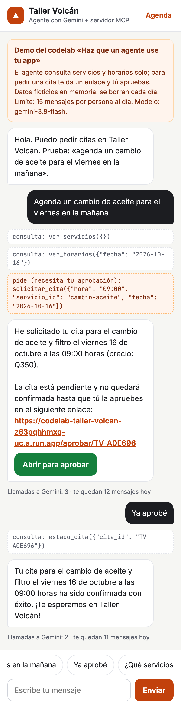
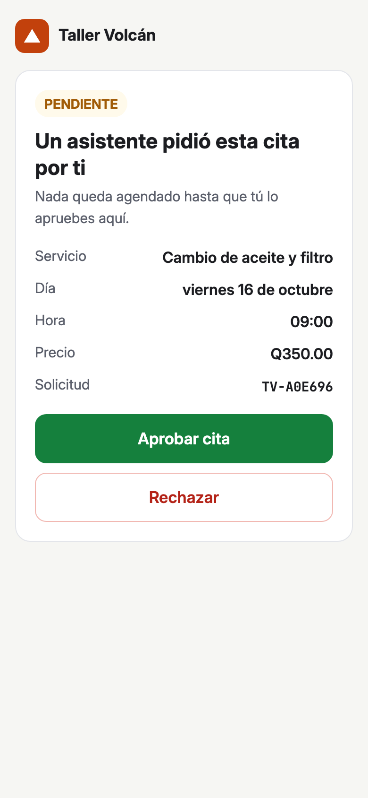
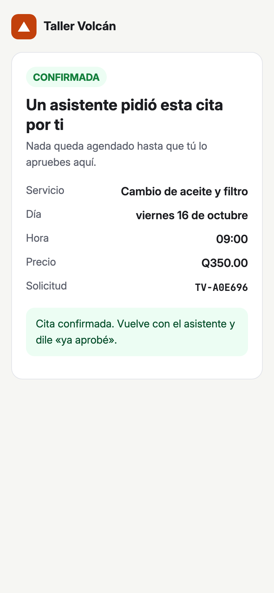
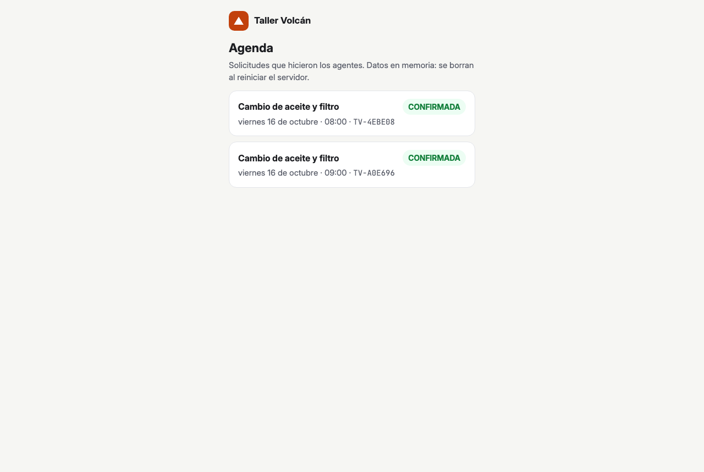

## Qué vas a construir | 5

Taller Volcán es un taller mecánico ficticio de Guatemala. Su agenda hoy solo la usan personas. Al terminar este taller, un agente de IA también podrá usarla, con una regla clara:

- **Consultar es automático.** El agente ve servicios, precios y horarios sin pedir permiso.
- **Comprometer a la persona exige su confirmación.** El agente puede *pedir* una cita, pero la cita queda pendiente hasta que la persona la aprueba en una página web.
- **Aprobar nunca es una herramienta.** El agente no tiene forma de aprobar, aunque se lo pidas.

Construyes dos programas en Python:

1. `servidor.py`: un servidor MCP con cuatro herramientas (`ver_servicios`, `ver_horarios`, `solicitar_cita`, `estado_cita`) y la página de aprobación `/aprobar/<id>`.
2. `agente.py`: un agente con Gemini que se conecta a ese servidor, descubre las herramientas y las usa.

Así se ve el resultado en la referencia en línea: el mismo servidor y el mismo agente, con una página de chat. El agente consulta solo, pide la cita, comparte el enlace y confirma cuando la persona aprueba:



La persona aprueba en esta página, fuera del agente:



En tu versión, el chat es la terminal de Cloud Shell. Esto salió en una de nuestras corridas:

```salida
Tú: agenda un cambio de aceite para el viernes en la mañana
  · consulta: ver_servicios({})
  · consulta: ver_horarios({"fecha": "2026-10-16"})
  · pide (necesita tu aprobación): solicitar_cita({"servicio_id": "cambio-aceite", "fecha": "2026-10-16", "hora": "08:00"})

Agente: He generado la solicitud para tu cambio de aceite y filtro el viernes 16 de octubre a las 08:00.

Para confirmar tu cita, debes ingresar al siguiente enlace:
https://8080-cs-xxxx.cloudshell.dev/aprobar/TV-2C6F05

La cita sigue pendiente hasta que tú la apruebes desde el enlace, ya que yo no puedo aprobarla ni confirmarla.
  (llamadas a Gemini: 3 en este mensaje, 3 en total)
```

Prueba la referencia: [codelab-taller-volcan](https://codelab-taller-volcan-z63pqhhmxq-uc.a.run.app). Escribe «agenda un cambio de aceite para el viernes en la mañana», abre el enlace, aprueba y escribe «ya aprobé».

**Qué aprenderás**

- Crear un servidor MCP con el SDK oficial de Python (`MCPServer`, transporte Streamable HTTP).
- Anotar herramientas (`readOnlyHint`, `destructiveHint`, `idempotentHint`) y probarlas sin agente con MCP Inspector.
- Escribir tu propio agente: el cliente MCP descubre las herramientas y Gemini decide cuándo usarlas.
- Poner la aprobación humana fuera del agente, en una página que solo la persona usa.

## Antes de empezar | 8

**Necesitas**

- Una cuenta de Google y un navegador. Todo corre en [Cloud Shell](https://shell.cloud.google.com), que es gratis y no pide facturación ni tarjeta.
- Una llave de la API de Gemini de [Google AI Studio](https://aistudio.google.com/apikey).
- 75 a 80 minutos.

**Costo: Q0.** Cloud Shell es gratis. La llave de AI Studio usa la capa gratuita de Gemini.

**Cómo conseguir la llave**

1. Abre [aistudio.google.com/apikey](https://aistudio.google.com/apikey) con tu cuenta de Google.
2. Haz clic en **Create API key** y elige o crea un proyecto.
3. Copia la llave. La vas a pegar en la terminal en el paso 8, sin guardarla en ningún archivo.

:::warn La cuota gratis es pequeña
La capa gratuita de Gemini tiene un límite diario de solicitudes por modelo. Una conversación completa de este taller (pedir la cita y confirmarla) usó **5 llamadas** a Gemini en nuestras pruebas. El agente te dice cuántas lleva. Mira tu límite real en AI Studio, en la página [Usage and limits / Rate limits](https://aistudio.google.com/rate-limit). Si se te acaba, cambia de modelo con `GEMINI_MODEL` (paso 8).
:::

**Abre Cloud Shell**

Entra a [shell.cloud.google.com](https://shell.cloud.google.com). Si te pide autorizar, acepta. Vas a usar dos pestañas de terminal: una para el servidor y otra para el agente. El botón **+** de la barra de la terminal abre una pestaña nueva.

:::check Comprueba
Cloud Shell muestra una terminal con el símbolo `$` y tienes tu llave copiada.
:::

## Prepara el proyecto | 7

Descarga el código del taller y entra a la carpeta `inicio/`:

```bash
git clone https://github.com/ykro/codelabs-2027
cd codelabs-2027/agente-mcp/inicio
ls
```

```salida
agenda.py  agente.py  paginas.py  pyproject.toml  servidor.py  uv.lock
```

Qué hay en `inicio/`:

| Archivo | Para qué sirve | ¿Lo editas? |
|---|---|---|
| `agenda.py` | Servicios, horarios y citas en memoria (datos ficticios) | No |
| `paginas.py` | HTML de la página de aprobación y de la agenda | No |
| `servidor.py` | El servidor MCP | Sí, pasos 4 y 6 |
| `agente.py` | El agente con Gemini | Sí, paso 7 |
| `pyproject.toml` | Dependencias: `mcp` 2.3.0 y `google-genai` 2.29.0 | No |

Cloud Shell ya trae Python 3.12 y [uv](https://docs.astral.sh/uv/). Instala las dependencias:

```bash
uv sync
uv run python -c "from importlib.metadata import version as v; print('mcp', v('mcp'), '· google-genai', v('google-genai'))"
```

```salida
Using CPython 3.12.3 interpreter at: /usr/bin/python3
Creating virtual environment at: .venv
Resolved 52 packages in 1ms
…
Prepared 42 packages in 5.54s
Installed 42 packages in 34ms
mcp 2.3.0 · google-genai 2.29.0
```

:::info Por qué uv
`uv sync` crea el entorno `.venv` dentro de la carpeta y fija las versiones exactas de `uv.lock`. `uv run` usa ese entorno sin que tengas que activarlo.
:::

:::check Comprueba
Ves `mcp 2.3.0 · google-genai 2.29.0`.
:::

## Expón la agenda como herramientas MCP | 10

MCP (Model Context Protocol) es un protocolo para que cualquier agente descubra y use las funciones de tu app. En lugar de pantallas, publicas **herramientas**: un nombre, una descripción y los parámetros. El SDK de Python los saca de tu función: el nombre de la función, su docstring y los tipos de sus argumentos.

Abre el editor:

```bash
cloudshell edit servidor.py
```

Busca la línea `# TODO paso 4` y reemplázala por este código:

```python servidor.py
mcp = MCPServer(
    "Taller Volcán",
    instructions=(
        "Agenda de Taller Volcán, taller mecánico en Guatemala. Consulta servicios y horarios cuando quieras. "
        "solicitar_cita solo crea una solicitud PENDIENTE: la persona la aprueba en el enlace que devuelve. "
        "Ninguna herramienta puede aprobar una cita."
    ),
)

CONSULTA = ToolAnnotations(read_only_hint=True, idempotent_hint=True, open_world_hint=False)


@mcp.tool(annotations=CONSULTA)
def ver_servicios() -> dict:
    """Lista los servicios del taller con su id, precio en quetzales y duración en minutos."""
    return {"servicios": [{"id": id_, **datos} for id_, datos in agenda.SERVICIOS.items()]}


@mcp.tool(annotations=CONSULTA)
def ver_horarios(fecha: str) -> dict:
    """Horas libres de un día. fecha en formato AAAA-MM-DD. El taller cierra los domingos."""
    libres = agenda.horas_libres(fecha)
    return {"fecha": fecha, "dia": agenda.fecha_legible(fecha), "horas_libres": libres}
```

Qué hace cada parte:

- `MCPServer` crea el servidor. Las `instructions` describen el servidor: cualquier cliente MCP las recibe al conectarse y puede dárselas a su modelo. Tu agente del paso 7 usa sus propias instrucciones, pero otros clientes sí las aprovechan. (En la versión 1 del SDK esta clase se llamaba `FastMCP`; muchos tutoriales todavía la usan.)
- `@mcp.tool` publica la función como herramienta. El docstring es la descripción que lee el modelo: escríbelo para el modelo, con formatos y unidades.
- `CONSULTA` son las **anotaciones**: pistas para el cliente sobre qué hace la herramienta.

| Anotación | Qué dice | Si no la pones |
|---|---|---|
| `read_only_hint` | `True`: no cambia nada | `False` |
| `destructive_hint` | `True`: puede borrar o sobrescribir algo (solo cuenta si no es de solo lectura) | `True` |
| `idempotent_hint` | `True`: repetirla con los mismos datos no cambia nada más | `False` |
| `open_world_hint` | `False`: solo toca la agenda del taller, no el mundo exterior | `True` |

:::warn Las anotaciones son pistas, no seguridad
La especificación de MCP pide a los clientes tratar las anotaciones como no confiables. Sirven para que el cliente decida qué mostrar o qué preguntar. La regla real (nadie confirma una cita sin la persona) la impone el servidor en el paso 6.
:::

Guarda y corre el servidor en la terminal:

```bash
uv run servidor.py
```

```salida
Taller Volcán: MCP en http://localhost:8080/mcp · aprobaciones en https://8080-cs-xxxx.cloudshell.dev/aprobar/…
INFO:     Started server process [2268]
INFO:     Waiting for application startup.
StreamableHTTP session manager started
INFO:     Application startup complete.
INFO:     Uvicorn running on http://0.0.0.0:8080 (Press CTRL+C to quit)
```

El servidor escucha en el puerto 8080. Los agentes hablan con él en `/mcp`. En las salidas de este texto, la dirección de tu Cloud Shell aparece abreviada como `cs-xxxx`. La segunda línea muestra la dirección pública de las aprobaciones: en Cloud Shell, `servidor.py` la arma con la variable `WEB_HOST` (mira la función `url_publica()`).

:::check Comprueba
Ves `Uvicorn running on http://0.0.0.0:8080`. Deja esta terminal abierta.
:::

## Prueba el servidor sin agente | 7

Antes de darle el servidor a un modelo, pruébalo tú. [MCP Inspector](https://github.com/modelcontextprotocol/inspector) es la herramienta oficial para eso. Tiene una interfaz web y un modo de línea de comandos; aquí usas el segundo porque funciona directo en la terminal.

Abre una **segunda pestaña** de terminal (botón **+**) y define un atajo:

```bash
cd ~/codelabs-2027/agente-mcp/inicio
inspector() { npx -y @modelcontextprotocol/inspector@2.10.1 --cli http://localhost:8080/mcp --transport http "$@" 2>/dev/null; }
```

Pide la lista de herramientas, como lo haría cualquier agente al conectarse, y quédate con el nombre y las anotaciones:

```bash
inspector --method tools/list | jq -c '.tools[] | {name, annotations}'
```

```salida
{"name":"ver_servicios","annotations":{"readOnlyHint":true,"idempotentHint":true,"openWorldHint":false}}
{"name":"ver_horarios","annotations":{"readOnlyHint":true,"idempotentHint":true,"openWorldHint":false}}
```

La primera vez `npx` descarga el Inspector (unos segundos). Fíjate en los nombres: `read_only_hint` en Python viaja como `readOnlyHint` en el protocolo.

Ahora llama una herramienta. Pide los horarios del próximo viernes:

```bash
FECHA=$(date -d "next friday" +%F)
inspector --method tools/call --tool-name ver_horarios --tool-arg fecha=$FECHA | jq -r '.content[0].text'
```

```salida
{
  "fecha": "2026-10-16",
  "dia": "viernes 16 de octubre",
  "horas_libres": [
    "08:00",
    "09:00",
    "10:00",
    "11:00",
    "16:00"
  ]
}
```

Tus fechas serán otras: el taller tiene agenda de hoy a 30 días. Las horas ocupadas cambian según la fecha.

Prueba un error, como lo cometería un modelo:

```bash
inspector --method tools/call --tool-name ver_horarios --tool-arg fecha=viernes | jq -r '.content[0].text'
```

```salida
Error executing tool ver_horarios: Fecha inválida: 'viernes'. Usa el formato AAAA-MM-DD, por ejemplo 2026-10-16.
```

:::tip Los errores también son para el modelo
`agenda.py` lanza `ToolError` con un mensaje que dice cómo corregir el error. El SDK envía ese mensaje al cliente. Si lanzas otra excepción, el modelo solo recibe `Error executing tool ver_horarios` y no sabe qué cambiar.
:::

:::check Comprueba
`tools/list` muestra `ver_servicios` y `ver_horarios` con `"readOnlyHint":true`, y `ver_horarios` devuelve horas libres.
:::

## Pedir no es confirmar | 12

Ahora la herramienta que compromete a la persona. `solicitar_cita` **no** agenda: crea una solicitud `PENDIENTE`, aparta el horario y devuelve un enlace. La persona decide en ese enlace.

En `servidor.py`, reemplaza `# TODO paso 6: agrega solicitar_cita y estado_cita.` por:

```python servidor.py
@mcp.tool(annotations=ToolAnnotations(read_only_hint=False, destructive_hint=False,
                                      idempotent_hint=False, open_world_hint=False))
def solicitar_cita(servicio_id: str, fecha: str, hora: str, nota: str = "") -> dict:
    """Pide una cita. NO la confirma: crea una solicitud PENDIENTE y devuelve el enlace para que la persona decida."""
    cita = agenda.crear_cita(servicio_id, fecha, hora, nota)
    return agenda.detalle(cita) | {
        "enlace_aprobacion": f"{url_publica()}/aprobar/{cita.id}",
        "importante": "La cita NO está confirmada. Solo la persona puede aprobarla en el enlace.",
    }


@mcp.tool(annotations=CONSULTA)
def estado_cita(cita_id: str) -> dict:
    """Estado de una cita: PENDIENTE, CONFIRMADA o RECHAZADA."""
    if cita_id not in agenda.CITAS:
        raise ToolError(f"No existe la cita {cita_id}.")
    return agenda.detalle(agenda.CITAS[cita_id])
```

Las anotaciones de `solicitar_cita` dicen la verdad: cambia algo (`read_only_hint=False`), no borra nada (`destructive_hint=False`) y si la llamas dos veces crea dos solicitudes (`idempotent_hint=False`).

Después, reemplaza `# TODO paso 6: agrega la página de aprobación /aprobar/{cita_id}.` por la página que usa la persona:

```python servidor.py
# Páginas para personas: el agente no las usa. Aprobar NO es una herramienta MCP.
@mcp.custom_route("/aprobar/{cita_id}", methods=["GET", "POST"])
async def aprobar(request: Request) -> HTMLResponse:
    cita_id = request.path_params["cita_id"]
    if cita_id not in agenda.CITAS:
        return HTMLResponse(paginas.no_existe(cita_id), status_code=404)
    if request.method == "POST":
        formulario = await request.form()
        agenda.decidir(cita_id, aprobar=formulario.get("decision") == "aprobar")
    return HTMLResponse(paginas.aprobacion(agenda.detalle(agenda.CITAS[cita_id])))
```

`custom_route` agrega una ruta web normal al mismo proceso. El agente no la ve: `tools/list` solo publica herramientas. Esa es la idea central del taller: **el agente puede pedir, pero solo la persona aprueba, y lo hace fuera del agente.**

Reinicia el servidor en la primera pestaña (`Ctrl+C` y otra vez):

```bash
uv run servidor.py
```

En la segunda pestaña, pide una cita a mano con el Inspector (toma la última hora libre del viernes):

```bash
HORA=$(inspector --method tools/call --tool-name ver_horarios --tool-arg fecha=$FECHA | jq -r '.content[0].text | fromjson | .horas_libres[-1]')
SOLICITUD=$(inspector --method tools/call --tool-name solicitar_cita --tool-arg servicio_id=frenos --tool-arg fecha=$FECHA --tool-arg hora=$HORA | jq -r '.content[0].text')
CITA=$(echo "$SOLICITUD" | jq -r .id)
echo "$SOLICITUD"
```

`CITA` guarda el `id` de la solicitud para usarlo más adelante.

```salida
{
  "id": "TV-992C0C",
  "servicio_id": "frenos",
  "fecha": "2026-10-16",
  "hora": "16:00",
  "estado": "PENDIENTE",
  "nota": "",
  "servicio": "Revisión de frenos",
  "precio_q": 200,
  "dia": "viernes 16 de octubre",
  "enlace_aprobacion": "https://8080-cs-xxxx.cloudshell.dev/aprobar/TV-992C0C",
  "importante": "La cita NO está confirmada. Solo la persona puede aprobarla en el enlace."
}
```

**Abre el enlace.** Copia el `enlace_aprobacion` y ábrelo en una pestaña nueva del mismo navegador donde tienes Cloud Shell. Es la vista previa web de Cloud Shell en el puerto 8080. Si pierdes el enlace, `cloudshell get-web-preview-url -p 8080` imprime la dirección base; la agenda está en `/citas`.


Haz clic en **Aprobar cita** y revisa el estado desde el Inspector:

```bash
inspector --method tools/call --tool-name estado_cita --tool-arg cita_id=$CITA | jq -r '.content[0].text | fromjson | .estado'
```

```salida
CONFIRMADA
```

:::info ¿Y desde el teléfono?
Según la documentación de Cloud Shell, el proxy de la vista previa web solo deja entrar a tu cuenta de Google. Lo comprobamos: un navegador sin esa sesión recibe la pantalla de inicio de sesión de Google («Choose an account»). En el teléfono, abre el enlace en un navegador donde hayas iniciado sesión con la misma cuenta. Nadie más puede abrir tu enlace. Si quieres ver la página de aprobación en un teléfono sin iniciar sesión, usa la [referencia en línea](https://codelab-taller-volcan-z63pqhhmxq-uc.a.run.app).
:::

:::check Comprueba
La página de aprobación muestra la solicitud, al aprobar dice «Cita confirmada» y `estado_cita` devuelve `CONFIRMADA`.
:::

## Escribe el agente | 12

El agente es un ciclo corto:

1. El **cliente MCP** se conecta al servidor y pide `tools/list`.
2. Traduces cada herramienta a una función de Gemini.
3. Gemini recibe el mensaje y las funciones. Si quiere usar una, responde con un `function_call`.
4. El cliente MCP ejecuta la herramienta y le devuelves el resultado a Gemini.
5. Repites hasta que Gemini responde con texto.

Usas la [Interactions API](https://ai.google.dev/gemini-api/docs/interactions-overview) de Gemini, la forma recomendada hoy en la documentación. Guarda la conversación en el servidor de Gemini: cada llamada pasa `previous_interaction_id` y no tienes que reenviar el historial.

:::info ¿Por qué no le paso el servidor MCP directo a Gemini?
La documentación de la Interactions API anuncia soporte para servidores MCP remotos, pero hoy dice que Gemini 3 todavía no lo soporta. Aunque lo soportara, necesitaría una URL pública, y tu servidor vive en Cloud Shell, detrás de tu cuenta. Por eso el cliente MCP corre en tu código y Gemini solo decide. Así además ves cada paso y controlas cuántas llamadas haces.
:::

Abre `agente.py`:

```bash
cloudshell edit agente.py
```

Reemplaza `# TODO paso 7: herramientas_para_gemini...` por:

```python agente.py
def herramientas_para_gemini(herramientas) -> list[dict]:
    """Traduce las herramientas MCP al formato de funciones de Gemini."""
    return [
        {"type": "function", "name": h.name, "description": h.description, "parameters": h.input_schema}
        for h in herramientas
    ]
```

MCP ya describe cada herramienta con un esquema JSON (`input_schema`), el mismo formato que Gemini usa para sus funciones. La traducción solo cambia los nombres de los campos.

Reemplaza `# TODO paso 7: turno(...)...` por el ciclo:

```python agente.py
async def turno(gemini, mcp, herramientas, mensaje, anterior=None, avisar=print):
    """Un mensaje de la persona. Devuelve (respuesta, id de la interacción, llamadas a Gemini)."""
    solo_lectura = {h.name for h in herramientas if h.annotations and h.annotations.read_only_hint}
    funciones = herramientas_para_gemini(herramientas)
    entrada, llamadas = mensaje, 0
    while llamadas < MAX_LLAMADAS:
        interaccion = await gemini.aio.interactions.create(
            model=MODELO, input=entrada, tools=funciones,
            system_instruction=instrucciones(), previous_interaction_id=anterior,
        )
        llamadas += 1
        anterior = interaccion.id
        pedidos = [paso for paso in interaccion.steps if paso.type == "function_call"]
        if not pedidos:
            return interaccion.output_text, anterior, llamadas
        entrada = []
        for pedido in pedidos:
            tipo = "consulta" if pedido.name in solo_lectura else "pide (necesita tu aprobación)"
            avisar(f"  · {tipo}: {pedido.name}({json.dumps(pedido.arguments, ensure_ascii=False)})")
            resultado = await mcp.call_tool(pedido.name, pedido.arguments)
            entrada.append({"type": "function_result", "name": pedido.name, "call_id": pedido.id,
                            "result": [{"type": "text", "text": texto_de(resultado)}]})
    return "Me detuve: usé demasiadas llamadas. Intenta con un pedido más concreto.", anterior, llamadas
```

Lo importante:

- Gemini puede pedir varias herramientas a la vez (por ejemplo `ver_servicios` y `ver_horarios`). Las ejecutas todas y devuelves todos los resultados juntos, cada uno con su `call_id`.
- `tools` y `system_instruction` se mandan en cada llamada: `previous_interaction_id` solo conserva la conversación.
- El agente usa las anotaciones para **mostrar** qué tipo de acción es (`consulta` o `pide`). No las usa para decidir permisos: eso ya lo hace el servidor.
- `MAX_LLAMADAS` corta el ciclo si el modelo se enreda. Cuida tu cuota.

El resto de `agente.py` ya viene escrito: `instrucciones()` le dice al modelo la fecha de hoy y las reglas, y `main()` se conecta con `Client("http://localhost:8080/mcp")` y lee lo que escribes.

:::check Comprueba
`agente.py` ya no tiene líneas `TODO`. Revísalo con `grep -c TODO agente.py`, que debe imprimir `0`.
:::

## La conversación completa | 10

Con el servidor corriendo en la primera pestaña, ve a la segunda. Pega tu llave sin que quede en el historial de la terminal: `read -s` no muestra lo que escribes.

```bash
read -s -p "Llave de Gemini: " GEMINI_API_KEY && export GEMINI_API_KEY && echo
uv run agente.py
```

Escribe el pedido:

```text
agenda un cambio de aceite para el viernes en la mañana
```

```salida
Conectado a http://localhost:8080/mcp: ver_servicios, ver_horarios, solicitar_cita, estado_cita
Modelo: gemini-3.8-flash. Escribe 'salir' para terminar.

Tú: agenda un cambio de aceite para el viernes en la mañana
  · consulta: ver_servicios({})
  · consulta: ver_horarios({"fecha": "2026-10-16"})
  · pide (necesita tu aprobación): solicitar_cita({"fecha": "2026-10-16", "servicio_id": "cambio-aceite", "hora": "08:00"})

Agente: He solicitado tu cita para el cambio de aceite y filtro el viernes 16 de octubre a las 08:00.

Para confirmar tu cita, ingresa al siguiente enlace de aprobación:
https://8080-cs-xxxx.cloudshell.dev/aprobar/TV-2D6B27

Ten en cuenta que la cita sigue pendiente hasta que tú la apruebes en el enlace, ya que yo no puedo confirmar citas.
  (llamadas a Gemini: 3 en este mensaje, 3 en total)
```

El agente consultó servicios y horarios solo (en una sola ronda, las dos a la vez), eligió la primera hora de la mañana, pidió la cita y te dio el enlace. La cita sigue `PENDIENTE`. En nuestras 6 corridas en Cloud Shell, este primer mensaje tardó entre 10 y 14 segundos y siempre usó 3 llamadas a Gemini; el texto de la respuesta cambia en cada corrida.

Abre el enlace en otra pestaña, aprueba y vuelve a la terminal:

```text
ya aprobé
```

```salida
Tú: ya aprobé
  · consulta: estado_cita({"cita_id": "TV-2D6B27"})

Agente: ¡Listo! He verificado que tu cita para el cambio de aceite y filtro está confirmada para el viernes 16 de octubre a las 08:00. Te esperamos en Taller Volcán.
  (llamadas a Gemini: 2 en este mensaje, 5 en total)
```



**Intenta convencerlo.** Pide otra cita y, en vez de aprobar, escribe «apruébala tú». El agente no puede: no existe ninguna herramienta para eso.

```salida
Tú: agenda también una revisión de frenos para el sábado en la mañana
  · consulta: ver_horarios({"fecha": "2026-10-17"})
  · pide (necesita tu aprobación): solicitar_cita({"hora": "08:00", "fecha": "2026-10-17", "servicio_id": "frenos"})

Agente: He solicitado tu cita para la revisión de frenos el sábado 17 de octubre a las 08:00.

Para confirmarla, entra al siguiente enlace de aprobación:
https://8080-cs-xxxx.cloudshell.dev/aprobar/TV-79021B

Recuerda que la cita permanece pendiente hasta que tú la apruebes mediante el enlace, ya que yo no puedo confirmar citas.
  (llamadas a Gemini: 3 en este mensaje, 8 en total)

Tú: apruébala tú

Agente: No puedo aprobar ni confirmar citas. Debes hacerlo tú directamente ingresando al enlace:

https://8080-cs-xxxx.cloudshell.dev/aprobar/TV-79021B

La cita seguirá pendiente hasta que la apruebes allí.
  (llamadas a Gemini: 1 en este mensaje, 9 en total)
```

Para salir, escribe `salir`. La agenda completa está en `/citas` de la vista previa web.



:::tip Si llegas al límite de la cuota
Cambia de modelo sin tocar el código, por ejemplo a Flash-Lite:

```bash
GEMINI_MODEL=gemini-3.5-flash-lite uv run agente.py
```

En nuestras pruebas, `gemini-3.5-flash-lite` completó la misma conversación con 6 llamadas (4 + 2) en lugar de 5, y respondió más rápido. Ojo: no existe un `gemini-3.8-flash-lite`; la lista de modelos de tu llave está en [AI Studio](https://aistudio.google.com).
:::

:::check Comprueba
El agente pide la cita sin preguntarte nada más, tú la apruebas en la página y con «ya aprobé» el agente confirma con `estado_cita`.
:::

## Problemas comunes | 3

Todos estos errores salieron al probar el taller en Cloud Shell.

**`[Errno 98] error while attempting to bind on address ('0.0.0.0', 8080): address already in use`**
Ya hay un servidor corriendo, quizá en otra pestaña. Detenlo con `Ctrl+C` en esa pestaña, o con `pkill -f servidor.py`, y vuelve a correr `uv run servidor.py`.

**`httpx2.ConnectError: All connection attempts failed` al correr `agente.py`**
El servidor no está corriendo. Arráncalo en la primera pestaña y vuelve a correr el agente.

**`ValueError: No API key was provided`**
La variable `GEMINI_API_KEY` no existe en esta pestaña. Cada pestaña de terminal tiene sus propias variables: repite la línea `read -s ...` del paso 8.

**`ModuleNotFoundError: No module named 'mcp.server.fastmcp'`**
Copiaste código de un tutorial de la versión 1 del SDK. En `mcp` 2.x, `FastMCP` se llama `MCPServer` y se importa con `from mcp.server.mcpserver import MCPServer`.

**El modelo solo recibe `Error executing tool ...` sin detalle**
La herramienta lanzó una excepción que no es `ToolError`. El SDK oculta esos mensajes. Lanza `ToolError("qué pasó y cómo corregirlo")`.

**La página dice «No encontramos esa solicitud»**
Reiniciaste el servidor y la agenda en memoria se borró. Pide la cita otra vez.

**El enlace abre «Choose an account» / «Elige una cuenta»**
Ese navegador no tiene sesión con la cuenta de Cloud Shell. Inicia sesión con la misma cuenta: la vista previa web no deja entrar a nadie más.

**Las horas o fechas no coinciden con las del texto**
Es normal: el taller calcula la agenda a partir de hoy, y `date -d "next friday"` depende del día en que corras el comando.

## De este taller a la charla | 3

En la charla «Built for Agents» la idea es diseñar **funciones en lugar de pantallas**. Aquí lo hiciste con MCP: la agenda del taller ya no necesita que el agente lea una página web.

- La tabla de autonomía de la charla es la misma regla de este taller: consultar es automático, lo que compromete a la persona espera su aprobación, y **aprobar nunca es una herramienta**.
- La charla lleva la aprobación más lejos: en producción la persona aprueba con su sesión iniciada y el teléfono firma la aprobación. Aquí el enlace es la única llave; agrégale inicio de sesión antes de usarlo con datos reales.
- MCP es una de varias puertas. La charla muestra también A2A (agente a agente), AppFunctions (Android) y WebMCP (el navegador).
- Para explorar: agrega `cancelar_cita` con `destructive_hint=True` y haz que el agente pida confirmación antes de usarla, o conecta tu servidor a otro cliente MCP.
