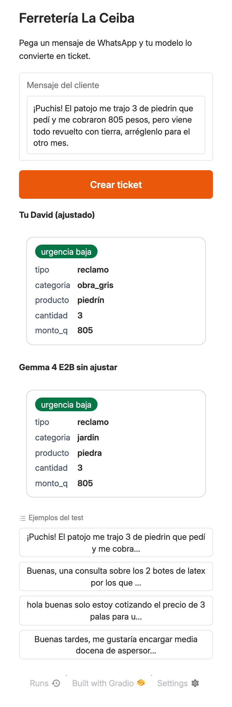
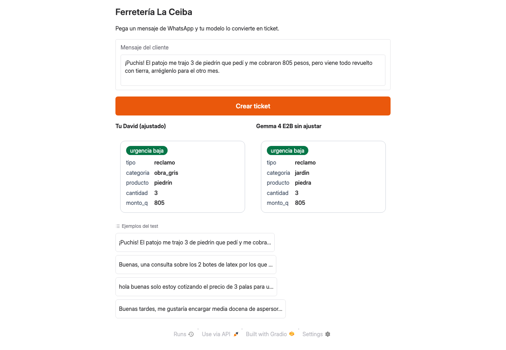
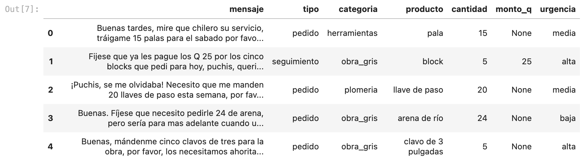
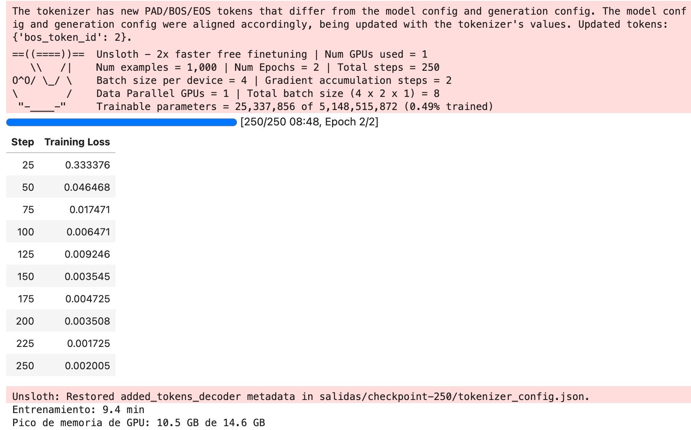
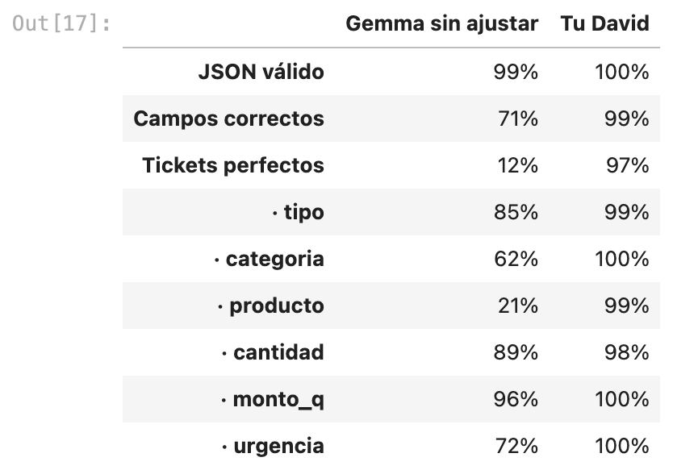
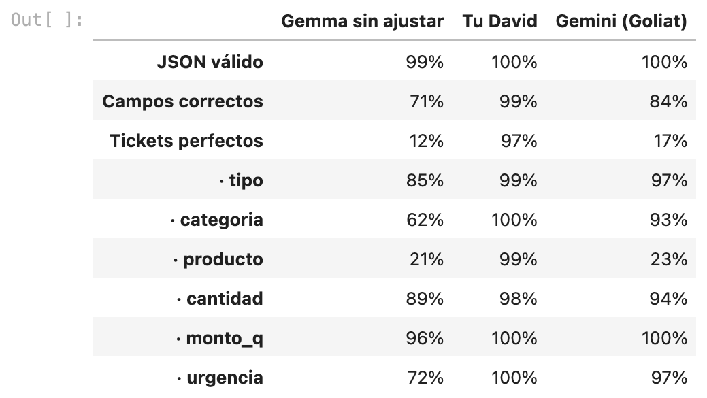
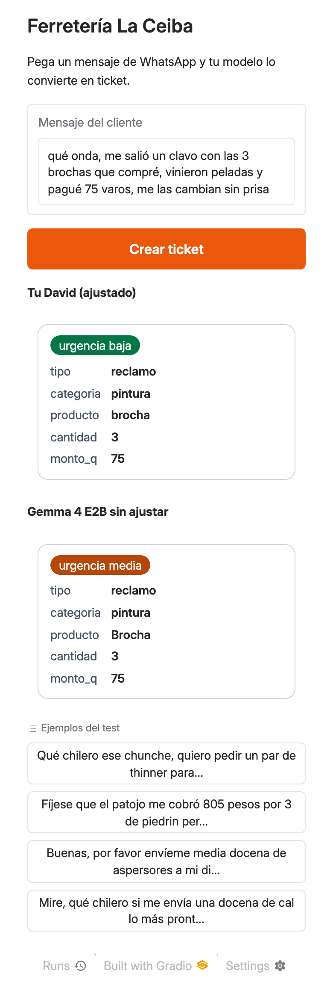

## Qué vas a construir | 3

Ferretería La Ceiba (una tienda inventada de Guatemala) recibe pedidos por WhatsApp. Los clientes escriben como hablan: «ocupo media docena de tubos de media para hoy, tengo una fuga», «me cobraron 65 varos de más por la pala». Vas a enseñarle a un modelo pequeño, **Gemma 4 E2B**, a convertir cada mensaje en un ticket con 6 campos fijos:

```json
{"tipo": "reclamo", "categoria": "pintura", "producto": "brocha", "cantidad": 3, "monto_q": 75, "urgencia": "baja"}
```

Al final tendrás tu modelo ajustado respondiendo en una app web que abres en el teléfono, junto al mismo modelo sin ajustar para comparar:





Y una tabla que mide los dos con 150 mensajes de prueba que el modelo nunca vio al entrenar. En la corrida de prueba de este taller, en una GPU T4:

| Medida | Gemma sin ajustar | Tu David |
|---|---|---|
| JSON válido | 96 % | 100 % |
| Campos correctos | 76 % | 99 % |
| Tickets perfectos | 23 % | 94 % |

Esos 150 mensajes son sintéticos y salen del mismo generador que los de entrenamiento: la tabla mide qué tan bien aprendió el modelo las reglas de la tienda con mensajes de ese estilo, no con mensajes reales de clientes. En el paso 10 lo pruebas con mensajes tuyos.

**Referencia en línea:** el [notebook con todas las salidas de esa corrida](https://github.com/ykro/codelabs-2027/blob/main/entrena-tu-david/solucion/entrena_tu_david.ipynb) se ve en GitHub, celda por celda.

Qué aprenderás:

- Por qué un dataset propio, con reglas de tu negocio, le enseña a un modelo pequeño lo que un modelo grande no sabe.
- Cómo ajustar Gemma 4 E2B con LoRA y Unsloth en la GPU gratis de Colab.
- Cómo medir antes y después con un test separado, con medidas que se entienden sin saber de ML.
- Cómo probar tu modelo en una app de Gradio y llevarlo a tu laptop con Ollama.

## Antes de empezar | 5

Necesitas:

- Una **cuenta de Google** y un navegador. Todo corre en [Google Colab](https://colab.research.google.com) con la GPU T4 gratis.
- Unos **80 minutos**. El paso más largo es el entrenamiento: 9 minutos en la prueba.
- **Costo: 0.** Colab gratis alcanza. No necesitas tarjeta, ni cuenta de Hugging Face: el modelo `unsloth/gemma-4-E2B-it` es público (licencia Apache 2.0) y se descarga sin aceptar licencias ni usar tokens.

Opcional:

- **Para comparar con Gemini (paso 9):** una llave de la API de Gemini. Entra a [Google AI Studio](https://aistudio.google.com/apikey), toca **Create API key** y cópiala. La capa gratuita sirve; ese paso usa 6 solicitudes. Tu cuota real está en [aistudio.google.com/usage](https://aistudio.google.com/usage).
- **Para correr tu modelo en tu laptop (paso 11):** [Ollama](https://ollama.com/download) instalado, Python 3, una terminal y unos 18 GB libres en disco.

:::info Cómo se probó este taller
El notebook se ejecutó completo, celda por celda y tal como está aquí (las dos celdas del paso 11 en una sesión nueva, sin el modelo en memoria), con la imagen oficial del entorno de Colab en una máquina de Google Cloud parecida a Colab gratis: GPU **Tesla T4** de 15 GB, 2 vCPU y 12 GB de RAM. Las cifras y los tiempos del texto salen de esa corrida. La celda opcional de Gemini se corrió aparte, con una llave de AI Studio, sobre los mismos datos. El paso 11 en la laptop se probó en una Mac con chip M1.
:::

:::check Listo para empezar
Tienes sesión en Google abierta y, si vas a hacer los pasos opcionales, tu llave de AI Studio a mano y Ollama instalado.
:::

## Abre el notebook e instala Unsloth | 6

Abre el notebook del taller en Colab con este enlace:

[Abrir `entrena_tu_david.ipynb` en Colab](https://colab.research.google.com/github/ykro/codelabs-2027/blob/main/entrena-tu-david/inicio/entrena_tu_david.ipynb)

1. Toca **Copiar en Drive** (arriba) para guardar tus cambios.
2. Menú **Entorno de ejecución → Cambiar tipo de entorno de ejecución → T4 GPU → Guardar**.
3. Corre las celdas en orden con **Shift + Enter**. No uses *Ejecutar todo*: cuatro celdas dicen `# TODO` y las vas a completar en los pasos 5, 7, 8 y 10.

:::tip Prefieres trabajar con los archivos
Todo el código está en el repositorio: `git clone https://github.com/ykro/codelabs-2027` o el zip desde GitHub. El notebook que abres está en `entrena-tu-david/inicio/` y el resultado completo en `entrena-tu-david/solucion/`.
:::

Primero comprueba que tienes GPU:

```python celda
!nvidia-smi --query-gpu=name,memory.total --format=csv
```

```salida
name, memory.total [MiB]
Tesla T4, 15360 MiB
```

Ahora instala Unsloth, la librería que hace el ajuste rápido y con poca memoria. Las versiones van fijas para que el taller funcione igual que cuando se probó:

```python celda
%%capture
!pip install --no-deps unsloth==2026.10.4 unsloth_zoo==2026.10.4 bitsandbytes==0.50.2 trl==1.15.0 cut_cross_entropy==25.1.1
!pip install sentencepiece protobuf "datasets==4.8.5" "huggingface_hub>=1.5.0,<2.0" hf_transfer gradio==6.26.0
!pip install --no-deps transformers==5.5.0 "tokenizers>=0.22.0,<=0.23.0" "torchao>=0.16.0"
```

La celda no muestra nada: `%%capture` esconde el registro de `pip`. En la prueba tardó 35 segundos. Comprueba qué quedó instalado:

```python celda
import unsloth, transformers, trl, peft, gradio
print("unsloth", unsloth.__version__, "· transformers", transformers.__version__,
      "· trl", trl.__version__, "· peft", peft.__version__, "· gradio", gradio.__version__)
```

```salida
🦥 Unsloth: Will patch your computer to enable 2x faster free finetuning.
🦥 Unsloth Zoo will now patch everything to make training faster!
unsloth 2026.10.4 · transformers 5.5.0 · trl 1.15.0 · peft 0.20.0 · gradio 6.26.0
```

:::check Unsloth instalado
Ves la línea con las versiones y ningún error.
:::

## Carga Gemma 4 E2B | 4

Gemma 4 E2B es el modelo pequeño de la familia Gemma 4: unos 2 mil millones de parámetros que trabajan en cada paso (5 mil millones contando las tablas de vocabulario y las partes de imagen y audio).

```python celda
from unsloth import FastModel
from unsloth.chat_templates import get_chat_template

model, tokenizer = FastModel.from_pretrained(
    model_name="unsloth/gemma-4-E2B-it",
    max_seq_length=1024,
    load_in_4bit=False,
)
tokenizer = get_chat_template(tokenizer, chat_template="gemma-4")
```

`get_chat_template` deja el formato de conversación de Gemma 4 (turnos `<|turn>user` y `<|turn>model`) que usarás para entrenar y para preguntar. La primera vez descarga unos 10 GB; en la prueba la celda tardó 2 minutos:

```salida
==((====))==  Unsloth 2026.10.4: Fast Gemma4 patching. Transformers: 5.5.0.
   \\   /|    Tesla T4. Num GPUs = 1. Max memory: 14.562 GB. Platform: Linux.
O^O/ \_/ \    Torch: 2.11.0+cu128. CUDA: 7.5. CUDA Toolkit: 12.8. Triton: 3.6.0
\        /    Bfloat16 = FALSE. FA [Xformers = None. FA2 = False]
 "-____-"     Free license: http://github.com/unslothai/unsloth
Unsloth: Fast downloading is enabled - ignore downloading bars which are red colored!
Unsloth: Using float16 precision for gemma4 won't work! Using float32.
Unsloth: QLoRA and full finetuning all not selected. Switching to 16bit LoRA.
```

La T4 no trabaja en `bfloat16` (`Bfloat16 = FALSE`) y Gemma 4 no funciona bien en `float16`, así que Unsloth usa `float32` por su cuenta. No tienes que cambiar nada. Mira cuánta memoria de la GPU ocupa el modelo:

```python celda
import torch

gpu = torch.cuda.get_device_properties(0)
print(f"GPU: {gpu.name} · memoria total: {gpu.total_memory / 1024**3:.1f} GB")
print(f"Memoria reservada después de cargar: {torch.cuda.max_memory_reserved() / 1024**3:.1f} GB")
```

```salida
GPU: Tesla T4 · memoria total: 14.6 GB
Memoria reservada después de cargar: 10.3 GB
```

:::check Modelo cargado
El resumen dice `Fast Gemma4 patching`, muestra `Tesla T4` y la memoria reservada anda por 10 GB de 14.6.
:::

## Mira el dataset y escribe el prompt | 7

El dataset tiene 1000 mensajes para entrenar y 150 para medir. Son sintéticos: un script sorteó cada ticket (la respuesta correcta) con el catálogo y las reglas de la tienda, Gemini escribió un mensaje de WhatsApp que lo expresa, y reglas en código descartaron los que no cumplían o no tenían sentido (por ejemplo, una «fuga» con clavos). Los detalles están en [`datos/DATOS.md`](https://github.com/ykro/codelabs-2027/blob/main/entrena-tu-david/datos/DATOS.md). Licencia CC BY 4.0.

```python celda
import json, os, urllib.request

URL = "https://raw.githubusercontent.com/ykro/codelabs-2027/main/entrena-tu-david/datos"
for nombre in ["train.jsonl", "test.jsonl"]:
    if not os.path.exists(nombre):  # si subiste el archivo a Colab, usa el tuyo
        urllib.request.urlretrieve(f"{URL}/{nombre}", nombre)

train = [json.loads(linea) for linea in open("train.jsonl", encoding="utf-8")]
test = [json.loads(linea) for linea in open("test.jsonl", encoding="utf-8")]
print(f"train: {len(train)} ejemplos · test: {len(test)} ejemplos")
```

```salida
train: 1000 ejemplos · test: 150 ejemplos
```

:::info Si GitHub no responde
La celda descarga los archivos del repositorio. Si falla, baja `train.jsonl` y `test.jsonl` de la carpeta `datos/` del repo, súbelos con el ícono de carpeta del panel izquierdo de Colab y vuelve a correr la celda: si el archivo ya existe, no lo descarga.
:::

Mira los primeros cinco:

```python celda
import pandas as pd

pd.set_option("display.max_colwidth", 90)
pd.DataFrame([{"mensaje": r["mensaje"], **r["ticket"]} for r in train[:5]], dtype=object)
```



Cada registro guarda su origen: qué modelo lo escribió, con qué semilla y qué frases se le pidieron.

```python celda
print(json.dumps(train[0]["origen"], ensure_ascii=False, indent=1))
```

```salida
{
 "tipo": "sintetico",
 "modelo": "gemini-3.8-flash",
 "servicio": "Vertex AI",
 "fecha": "2026-10-13",
 "semilla": 1821,
 "solicitud": "train-1821-00001",
 "pistas": {
  "producto_como": [
   "pala",
   "palas"
  ],
  "cantidad_como": "15",
  "monto_como": null,
  "urgencia_como": "para el sabado",
  "estilo": [
   "usa «patojo»",
   "usa «chilero»"
  ]
 },
 "validacion": "reglas de generar_datos.py: ok"
}
```

Lo que el modelo tiene que aprender son reglas **de esta tienda**, que ningún modelo general conoce:

- El producto se escribe con el nombre del catálogo, en singular: «tubos de media» → `tubo pvc 1/2`, «breakers» → `flipón`, «focos» → `foco led`, «abono» → `fertilizante`.
- Las categorías son las de la tienda: el pegamento PVC y el teflón van en `plomeria`; el machete en `jardin`; la carretilla en `herramientas`; los clavos en `obra_gris`.
- La urgencia sigue una regla fija: `alta` = hoy o emergencia, `media` = con fecha en los próximos días, `baja` = sin fecha.

Ahora completa la primera celda `# TODO` con el prompt. Es el mismo para el modelo base, para entrenar, para Gemini y para la app: así la comparación es justa. Pide el producto «como lo vende la tienda, en singular», pero no trae el catálogo: el modelo ajustado lo aprende de los ejemplos.

```python celda
PROMPT = """Eres el asistente de Ferretería La Ceiba, en Guatemala. Convierte el mensaje del cliente en un ticket JSON con estos campos:
- tipo: pedido, cotizacion, reclamo o seguimiento
- categoria: obra_gris, techos, plomeria, electricidad, pintura, herramientas o jardin
- producto: el nombre del producto como lo vende la tienda, en singular
- cantidad: número entero, o null si no la dice
- monto_q: monto en quetzales, o null si no lo dice
- urgencia: alta, media o baja
Responde solo con el JSON.

Mensaje: {mensaje}"""


def conversacion(mensaje, ticket=None):
    turnos = [{"role": "user", "content": [{"type": "text", "text": PROMPT.format(mensaje=mensaje)}]}]
    if ticket is not None:
        respuesta = json.dumps(ticket, ensure_ascii=False)
        turnos.append({"role": "assistant", "content": [{"type": "text", "text": respuesta}]})
    return turnos
```

`conversacion()` arma los turnos del chat. Sin `ticket`, sirve para preguntar; con `ticket`, agrega la respuesta correcta y sirve para entrenar.

:::check Datos y prompt listos
Ves `train: 1000 ejemplos · test: 150 ejemplos`, la tabla y el origen del primer registro. La celda del prompt corre sin salida.
:::

## Mide el modelo base | 7

Antes de entrenar, mide. Si no sabes cuánto acierta el modelo sin ajustar, no sabrás si el ajuste sirvió.

Estas son las tres medidas, en palabras simples:

- **JSON válido**: la respuesta se puede leer como un ticket con los 6 campos y valores permitidos (si viene envuelta en ` ```json `, se le quita el envoltorio; si trae texto alrededor, no cuenta).
- **Campos correctos**: de todos los campos de todos los mensajes, cuántos coinciden con la respuesta correcta. Los textos se comparan sin mayúsculas ni tildes («Brocha» cuenta igual que `brocha`) y los números por su valor (`"15"` cuenta igual que `15`). Un JSON inválido cuenta como 6 campos fallados.
- **Tickets perfectos**: mensajes con los 6 campos bien. Es la medida que importa para la tienda: un ticket con un campo malo hay que corregirlo a mano.

```python celda
import re, unicodedata

CAMPOS = ["tipo", "categoria", "producto", "cantidad", "monto_q", "urgencia"]
PERMITIDOS = {
    "tipo": ["pedido", "cotizacion", "reclamo", "seguimiento"],
    "categoria": ["obra_gris", "techos", "plomeria", "electricidad", "pintura", "herramientas", "jardin"],
    "urgencia": ["alta", "media", "baja"],
}


def normalizar(texto):
    t = unicodedata.normalize("NFKD", str(texto).lower())
    return " ".join("".join(c for c in t if not unicodedata.combining(c)).split())


def leer_ticket(respuesta):
    """El ticket que escribió el modelo, o None si no es un JSON válido con los 6 campos."""
    texto = re.sub(r"^```(?:json)?|```$", "", respuesta.strip()).strip()
    try:
        ticket = json.loads(texto)
    except json.JSONDecodeError:
        return None
    if not isinstance(ticket, dict) or set(ticket) != set(CAMPOS):
        return None
    if any(ticket[c] not in valores for c, valores in PERMITIDOS.items()):
        return None
    return ticket


def igual(campo, a, b):
    if campo in ("cantidad", "monto_q"):
        try:
            return (a is None and b is None) or abs(float(a) - float(b)) < 0.01
        except (TypeError, ValueError):
            return False
    return normalizar(a) == normalizar(b)


def calificar(respuestas, filas):
    validos, perfectos, aciertos = 0, 0, {c: 0 for c in CAMPOS}
    for respuesta, fila in zip(respuestas, filas):
        ticket = leer_ticket(respuesta)
        if ticket is None:
            continue
        validos += 1
        bien = [igual(c, ticket[c], fila["ticket"][c]) for c in CAMPOS]
        for c, ok in zip(CAMPOS, bien):
            aciertos[c] += ok
        perfectos += all(bien)
    n = len(filas)
    return {"JSON válido": validos / n,
            "Campos correctos": sum(aciertos.values()) / (n * len(CAMPOS)),
            "Tickets perfectos": perfectos / n,
            **{f"· {c}": aciertos[c] / n for c in CAMPOS}}


def tabla(**columnas):
    return pd.DataFrame(columnas).map(lambda x: f"{x:.0%}")
```

`responder()` genera en lotes de 16 mensajes y sin azar (`do_sample=False`): con la misma entrada, siempre la misma salida.

```python celda
import time

texto_tok = getattr(tokenizer, "tokenizer", tokenizer)


def responder(mensajes, lote=16):
    texto_tok.padding_side = "left"  # para generar, el relleno va a la izquierda
    salidas = []
    for i in range(0, len(mensajes), lote):
        prompts = [tokenizer.apply_chat_template(conversacion(m), tokenize=False, add_generation_prompt=True)
                   for m in mensajes[i:i + lote]]
        entrada = texto_tok(prompts, return_tensors="pt", padding=True, add_special_tokens=False).to("cuda")
        salida = model.generate(**entrada, max_new_tokens=96, do_sample=False)
        salidas += texto_tok.batch_decode(salida[:, entrada["input_ids"].shape[1]:], skip_special_tokens=True)
    return salidas
```

Ahora mide los 150 mensajes del test. En la T4 de la prueba tardó 140 segundos:

```python celda
FastModel.for_inference(model)
inicio = time.time()
respuestas_base = responder([r["mensaje"] for r in test])
print(f"{len(test)} mensajes en {time.time() - inicio:.0f} s")
base = calificar(respuestas_base, test)
tabla(**{"Gemma sin ajustar": base})
```

```salida
150 mensajes en 140 s
                  Gemma sin ajustar
JSON válido                     96%
Campos correctos                76%
Tickets perfectos               23%
· tipo                          84%
· categoria                     61%
· producto                      57%
· cantidad                      89%
· monto_q                       91%
· urgencia                      73%
```

Mira tres respuestas del modelo base junto a la respuesta correcta:

```python celda
for fila, respuesta in list(zip(test, respuestas_base))[:3]:
    print("MENSAJE  ", fila["mensaje"])
    print("ESPERADO ", json.dumps(fila["ticket"], ensure_ascii=False))
    print("BASE     ", " ".join(respuesta.split()), "\n")
```

```salida
MENSAJE   Qué chilero ese chunche, quiero pedir un par de thinner para entrega porfa, tengo Q 140 para el otro mes.
ESPERADO  {"tipo": "pedido", "categoria": "pintura", "producto": "thinner", "cantidad": 2, "monto_q": 140, "urgencia": "baja"}
BASE      ```json { "tipo": "pedido", "categoria": "pintura", "producto": "Thinner", "cantidad": 2, "monto_q": 140, "urgencia": "media" } ```

MENSAJE   Fíjese que el patojo me cobró 805 pesos por 3 de piedrin pero vino de mala calidad, no me digan que lo solucionan mas adelante.
ESPERADO  {"tipo": "reclamo", "categoria": "obra_gris", "producto": "piedrín", "cantidad": 3, "monto_q": 805, "urgencia": "baja"}
BASE      ```json { "tipo": "reclamo", "categoria": "jardin", "producto": "Patojo", "cantidad": 3, "monto_q": 805, "urgencia": "alta" } ```

MENSAJE   Buenas tardes, fíjese que el patojo me cobró 195 varos por 5 llaves de paso pero vienen defectuosas, necesito que usted me las cambie hoy mismo por favor.
ESPERADO  {"tipo": "reclamo", "categoria": "plomeria", "producto": "llave de paso", "cantidad": 5, "monto_q": 195, "urgencia": "alta"}
BASE      ```json { "tipo": "reclamo", "categoria": "plomeria", "producto": "Llave de paso", "cantidad": 5, "monto_q": 195, "urgencia": "alta" } ```
```

El modelo base entiende el mensaje, pero no conoce la tienda: pone el piedrín en `jardin` (y hasta toma «patojo» como producto) y decide la urgencia a su manera.

:::check Tienes tu línea base
Ves la tabla con la columna «Gemma sin ajustar». En la prueba: 76 % de campos correctos y 23 % de tickets perfectos.
:::

## Configura LoRA | 5

Ajustar todo el modelo significaría cambiar 5 mil millones de números: no cabe en una T4. **LoRA** congela el modelo y le agrega, en cada capa, dos matrices pequeñas que sí aprenden. Al final, la respuesta del modelo es la original más una corrección aprendida.

Completa la segunda celda `# TODO`:

```python celda
model = FastModel.get_peft_model(
    model,
    finetune_vision_layers=False,     # solo texto: la parte de visión queda congelada
    finetune_language_layers=True,
    finetune_attention_modules=True,  # q, k, v, o
    finetune_mlp_modules=True,        # gate, up, down
    r=16,                             # tamaño de las matrices pequeñas que sí aprenden
    lora_alpha=16,                    # cuánto pesa lo aprendido (alpha / r = 1)
    lora_dropout=0,
    bias="none",
    random_state=3407,
)
model.print_trainable_parameters()
```

- `r=16`: el tamaño de esas matrices pequeñas. Más grande aprende más detalles, pero tarda más y puede memorizar el dataset. 8, 16 y 32 son valores comunes; 16 alcanza para 6 campos y 43 productos.
- `lora_alpha=16`: cuánto pesa la corrección frente al modelo original. Con `alpha` igual a `r`, la corrección entra con peso 1.
- **Módulos**: `attention` son las capas que deciden a qué palabras del mensaje poner atención (`q`, `k`, `v`, `o`); `mlp` son las que transforman lo que leyó (`gate`, `up`, `down`). Se ajustan las dos. La parte de visión queda congelada: este taller solo usa texto.

```salida
trainable params: 25,337,856 || all params: 5,148,515,872 || trainable%: 0.4921
```

:::check Adaptador listo
Solo entrena el 0.49 % de los parámetros: unos 25 millones de 5 mil millones.
:::

## Entrena | 14

Primero convierte cada ejemplo al formato de chat de Gemma 4, con la respuesta correcta como turno del modelo:

```python celda
from datasets import Dataset

textos = [tokenizer.apply_chat_template(conversacion(r["mensaje"], r["ticket"]), tokenize=False).removeprefix("<bos>")
          for r in train]
datos = Dataset.from_dict({"text": textos})
print(textos[0])
```

```salida
<|turn>user
Eres el asistente de Ferretería La Ceiba, en Guatemala. Convierte el mensaje del cliente en un ticket JSON con estos campos:
- tipo: pedido, cotizacion, reclamo o seguimiento
- categoria: obra_gris, techos, plomeria, electricidad, pintura, herramientas o jardin
- producto: el nombre del producto como lo vende la tienda, en singular
- cantidad: número entero, o null si no la dice
- monto_q: monto en quetzales, o null si no lo dice
- urgencia: alta, media o baja
Responde solo con el JSON.

Mensaje: Buenas tardes, mire que chilero su servicio, tráigame 15 palas para el sabado por favor, ahí el patojo va a estar esperando para recibirlas.<turn|>
<|turn>model
{"tipo": "pedido", "categoria": "herramientas", "producto": "pala", "cantidad": 15, "monto_q": null, "urgencia": "media"}<turn|>
```

Completa la tercera celda `# TODO` con la configuración del entrenamiento:

```python celda
from trl import SFTTrainer, SFTConfig
from unsloth.chat_templates import train_on_responses_only

trainer = SFTTrainer(
    model=model,
    tokenizer=tokenizer,
    train_dataset=datos,
    args=SFTConfig(
        dataset_text_field="text",
        per_device_train_batch_size=4,
        gradient_accumulation_steps=2,   # 4 x 2 = 8 ejemplos por paso
        num_train_epochs=2,              # cada ejemplo se ve 2 veces
        learning_rate=2e-4,
        warmup_steps=10,
        lr_scheduler_type="linear",
        optim="adamw_8bit",
        weight_decay=0.001,
        logging_steps=25,
        seed=3407,
        output_dir="salidas",
        report_to="none",
    ),
)
trainer = train_on_responses_only(trainer)  # solo aprende de la respuesta (el JSON), no del prompt
```

- Cada paso ve 8 ejemplos (4 a la vez, 2 veces antes de corregir) y el entrenamiento recorre el dataset 2 veces: 250 pasos.
- `learning_rate=2e-4` es cuánto corrige en cada paso; es el valor que recomienda Unsloth para LoRA.
- `train_on_responses_only` hace que el modelo aprenda solo del JSON y no gaste esfuerzo en repetir el prompt.

Ahora entrena. La última línea muestra el pico de memoria de la GPU:

```python celda
FastModel.for_training(model)
stats = trainer.train()
print(f"Entrenamiento: {stats.metrics['train_runtime'] / 60:.1f} min")
print(f"Pico de memoria de GPU: {torch.cuda.max_memory_reserved() / 1024**3:.1f} GB de {gpu.total_memory / 1024**3:.1f} GB")
```

Mientras corre, Colab muestra una barra de avance y una tabla con la pérdida (*loss*) cada 25 pasos. La pérdida es el error promedio del modelo al predecir la respuesta correcta: debe bajar. En la T4 de la prueba:

```salida
[250/250 08:48, Epoch 2/2]
Step  Training Loss
  25  0.333376
  50  0.046468
  75  0.017471
 100  0.006471
 125  0.009246
 150  0.003545
 175  0.004725
 200  0.003508
 225  0.001725
 250  0.002005
Entrenamiento: 9.4 min
Pico de memoria de GPU: 10.5 GB de 14.6 GB
```



:::info Si tu pérdida empieza mucho más alta
En la prueba empezó en 0.33. La guía de Unsloth para Gemma 4 dice que la pérdida de E2B puede empezar en 13–15 y que es normal; su notebook oficial en una T4 muestra 11–12 en los primeros pasos. Lo que importa es que baje.
:::

:::warn No cierres la pestaña
Si Colab se desconecta, pierdes el modelo entrenado y tienes que volver a cargar y entrenar. En la T4 de la prueba el entrenamiento tardó 9.4 minutos y la GPU llegó a 10.5 GB de 14.6.
:::

:::check Entrenado
La pérdida bajó y ves las líneas `Entrenamiento: … min` y `Pico de memoria de GPU`.
:::

## Mide tu David | 7

Mide con el mismo test y el mismo prompt:

```python celda
FastModel.for_inference(model)
respuestas_david = responder([r["mensaje"] for r in test])
david = calificar(respuestas_david, test)
tabla(**{"Gemma sin ajustar": base, "Tu David": david})
```

```salida
                  Gemma sin ajustar Tu David
JSON válido                     96%     100%
Campos correctos                76%      99%
Tickets perfectos               23%      94%
· tipo                          84%      99%
· categoria                     61%     100%
· producto                      57%     100%
· cantidad                      89%      97%
· monto_q                       91%     100%
· urgencia                      73%      99%
```



:::warn Qué mide este 94 %
Los 150 mensajes de prueba nunca se usaron para entrenar, pero salen del mismo generador que los de entrenamiento: mismo estilo, mismas frases de urgencia, mismo catálogo. El 94 % dice que tu David aprendió bien las reglas de la tienda con mensajes de ese estilo. Con mensajes reales de clientes, escritos de mil maneras, espera menos. En el paso 10 lo pruebas tú.
:::

Mira mensajes que el modelo base fallaba y tu David resuelve:

```python celda
cambios = [(f, b, d) for f, b, d in zip(test, respuestas_base, respuestas_david)
           if leer_ticket(d) and all(igual(c, leer_ticket(d)[c], f["ticket"][c]) for c in CAMPOS)
           and not (leer_ticket(b) and all(igual(c, leer_ticket(b)[c], f["ticket"][c]) for c in CAMPOS))]
print(f"{len(cambios)} mensajes que el modelo base fallaba y tu David resuelve. Tres de ellos:\n")
for fila, b, d in cambios[:3]:
    print("MENSAJE ", fila["mensaje"])
    print("BASE    ", " ".join(b.split()))
    print("DAVID   ", d.strip(), "\n")
```

```salida
107 mensajes que el modelo base fallaba y tu David resuelve. Tres de ellos:

MENSAJE  Qué chilero ese chunche, quiero pedir un par de thinner para entrega porfa, tengo Q 140 para el otro mes.
BASE     ```json { "tipo": "pedido", "categoria": "pintura", "producto": "Thinner", "cantidad": 2, "monto_q": 140, "urgencia": "media" } ```
DAVID    {"tipo": "pedido", "categoria": "pintura", "producto": "thinner", "cantidad": 2, "monto_q": 140, "urgencia": "baja"}

MENSAJE  Fíjese que el patojo me cobró 805 pesos por 3 de piedrin pero vino de mala calidad, no me digan que lo solucionan mas adelante.
BASE     ```json { "tipo": "reclamo", "categoria": "jardin", "producto": "Patojo", "cantidad": 3, "monto_q": 805, "urgencia": "alta" } ```
DAVID    {"tipo": "reclamo", "categoria": "obra_gris", "producto": "piedrín", "cantidad": 3, "monto_q": 805, "urgencia": "baja"}

MENSAJE  Buenas, por favor envíeme media docena de aspersores a mi dirección para el jueves. Quedo al pendiente de su confirmación, va pues.
BASE     ```json { "tipo": "pedido", "categoria": "jardin", "producto": "Aspersor", "cantidad": 15, "monto_q": null, "urgencia": "media" } ```
DAVID    {"tipo": "pedido", "categoria": "jardin", "producto": "aspersor", "cantidad": 6, "monto_q": null, "urgencia": "media"}
```

En estos tres, el modelo base falla la urgencia («para el otro mes» es `baja`), la categoría y el producto del piedrín, o la cantidad («media docena» no son 15). Tu David aprendió esas reglas de los ejemplos y además dejó de envolver el JSON en ` ```json `.

Guarda el adaptador. Lo usa el paso 11 y te sirve para volver a cargarlo sin entrenar (`FastModel.from_pretrained(model_name="david_lora", max_seq_length=1024, load_in_4bit=False)`):

```python celda
model.save_pretrained("david_lora")
_ = tokenizer.save_pretrained("david_lora")
!du -sh david_lora
```

```salida
Unsloth: Restored added_tokens_decoder metadata in david_lora/tokenizer_config.json.
128M	david_lora
```

:::info Opcional: compáralo con Gemini (Goliat)
¿Un modelo grande lo haría mejor? Guarda tu llave de AI Studio en Colab: ícono de llave (**Secretos**) en el panel izquierdo → **Agregar nuevo secreto** → nombre `GEMINI_API_KEY`, valor tu llave, y activa **Acceso del notebook**. Luego corre la celda opcional. Usa las mismas instrucciones del prompt y manda los 150 mensajes en 6 solicitudes de 25 para no gastar tu cuota diaria. Muestra el avance por solicitud; en la prueba tardó unos 3 minutos. Sin llave, la celda solo avisa y puedes seguir.
:::

```python celda
# Opcional: si no tienes llave de AI Studio, esta celda solo avisa y puedes seguir al paso 10.
from google import genai
from google.colab import userdata

MODELO_GEMINI = "gemini-3.8-flash"  # si llegas al límite del día: "gemini-3.5-flash-lite"
try:
    cliente = genai.Client(api_key=userdata.get("GEMINI_API_KEY"))
except Exception:
    cliente = None
    print("No encontré GEMINI_API_KEY en los secretos de Colab (o no le diste acceso). Salta este paso.")

if cliente:
    INSTRUCCIONES = (PROMPT.split("\n\nMensaje:")[0] + "\nVas a recibir varios mensajes numerados. "
                     "Responde con un arreglo JSON: un ticket por mensaje, en el mismo orden.")
    respuestas_gemini = []
    for i in range(0, len(test), 25):  # 25 mensajes por solicitud: 6 solicitudes en total
        grupo = test[i:i + 25]
        lista = "\n".join(f"{n}. {r['mensaje']}" for n, r in enumerate(grupo, 1))
        inicio = time.time()
        r = cliente.models.generate_content(model=MODELO_GEMINI, contents=f"{INSTRUCCIONES}\n\nMensajes:\n{lista}",
                                            config={"response_mime_type": "application/json", "temperature": 0})
        tickets = json.loads(r.text)[:len(grupo)]
        respuestas_gemini += [json.dumps(t, ensure_ascii=False) for t in tickets] + [""] * (len(grupo) - len(tickets))
        print(f"{len(respuestas_gemini)}/{len(test)} mensajes ({time.time() - inicio:.0f} s)")
    gemini = calificar(respuestas_gemini, test)
    display(tabla(**{"Gemma sin ajustar": base, "Tu David": david, "Gemini (Goliat)": gemini}))
```

Resultado en la prueba (con `gemini-3.8-flash`):

```salida
25/150 mensajes (40 s)
50/150 mensajes (26 s)
75/150 mensajes (37 s)
100/150 mensajes (29 s)
125/150 mensajes (45 s)
150/150 mensajes (10 s)
                  Gemma sin ajustar Tu David Gemini (Goliat)
JSON válido                     96%     100%            100%
Campos correctos                76%      99%             91%
Tickets perfectos               23%      94%             52%
· tipo                          84%      99%             98%
· categoria                     61%     100%             93%
· producto                      57%     100%             63%
· cantidad                      89%      97%             95%
· monto_q                       91%     100%            100%
· urgencia                      73%      99%             94%
```



Gemini entiende muy bien los mensajes: tipo, cantidad, monto y urgencia casi perfectos. Falla en el producto (63 %) porque no sabe cómo se llama cada cosa en el catálogo de esta tienda. Escribe lo que dijo el cliente («foco», «abono», «breaker», «arena») en vez de `foco led`, `fertilizante`, `flipón` o `arena de río`. Por eso llega a 52 % de tickets perfectos contra 94 % de tu David. Tu David no es más listo que Gemini: aprendió de mil ejemplos las convenciones de la tienda, que el prompt no trae. Con Gemini en solicitudes de un mensaje a la vez, en Vertex AI, salió parecido: 90 % de campos correctos y entre 47 y 49 % de tickets perfectos en dos corridas.

:::tip Ejercicio: dale el catálogo a Gemini
Agrega a `INSTRUCCIONES` la lista de los 43 nombres del catálogo (están en `datos/generar_datos.py`) y vuelve a correr la celda. ¿Cuánto sube Gemini? Es la alternativa a ajustar: escribir las reglas en el prompt en vez de enseñarlas con ejemplos.
:::

:::check Tienes tu tabla
Tu David supera al modelo base en campos correctos y en tickets perfectos.
:::

## Pruébalo en una app | 7

Completa la última celda `# TODO` con una app de Gradio. Muestra el ticket de tu David y, al lado, el del mismo modelo sin ajustar: `model.disable_adapter()` apaga el adaptador LoRA solo durante esa respuesta.

```python celda
import gradio as gr
from html import escape

COLORES = {"alta": "#b42318", "media": "#b54708", "baja": "#067647"}


def tarjeta(respuesta):
    ticket = leer_ticket(respuesta)
    if ticket is None:
        return f'<div class="t mal"><b>No es un ticket válido</b><pre>{escape(respuesta.strip())}</pre></div>'
    filas = "".join(f"<dt>{c}</dt><dd>{escape('—' if ticket[c] is None else str(ticket[c]))}</dd>"
                    for c in CAMPOS if c != "urgencia")
    color = COLORES[ticket["urgencia"]]
    return (f'<div class="t"><span class="u" style="background:{color}">urgencia {ticket["urgencia"]}</span>'
            f"<dl>{filas}</dl></div>")


def crear_ticket(mensaje):
    FastModel.for_inference(model)
    david = responder([mensaje])[0]
    with model.disable_adapter():
        sin_ajustar = responder([mensaje])[0]
    return tarjeta(david), tarjeta(sin_ajustar)


CSS = """
.gradio-container {max-width: 760px !important; margin: auto; font-size: 16px}
.t {border: 1px solid #d0d5dd; border-radius: 12px; padding: 14px; background: #fff}
.t.mal {border-color: #fda29b; background: #fef3f2}
.t pre {white-space: pre-wrap; font-size: 14px}
.t dl {display: grid; grid-template-columns: auto 1fr; gap: 6px 12px; margin: 10px 0 0}
.t dt {color: #475467} .t dd {margin: 0; font-weight: 600; overflow-wrap: anywhere}
.u {color: #fff; border-radius: 999px; padding: 3px 10px; font-size: 14px}
button {min-height: 48px}
"""
CLARO = "() => { document.body.classList.remove('dark'); }"
ejemplos = [f["mensaje"] for f, _, _ in cambios[:4]]

with gr.Blocks(title="Ferretería La Ceiba · tickets") as app:
    gr.Markdown("## Ferretería La Ceiba\nPega un mensaje de WhatsApp y tu modelo lo convierte en ticket.")
    mensaje = gr.Textbox(label="Mensaje del cliente", lines=3,
                         placeholder="buenas, ocupo 3 bolsas de cemento para hoy, la obra está parada")
    boton = gr.Button("Crear ticket", variant="primary")
    with gr.Row():
        with gr.Column():
            gr.Markdown("**Tu David (ajustado)**")
            salida_david = gr.HTML()
        with gr.Column():
            gr.Markdown("**Gemma 4 E2B sin ajustar**")
            salida_base = gr.HTML()
    gr.Examples(ejemplos, inputs=mensaje, label="Ejemplos del test")
    boton.click(crear_ticket, mensaje, [salida_david, salida_base])

app.launch(share=True, css=CSS, js=CLARO, theme=gr.themes.Default(font=["Inter", "system-ui", "sans-serif"]))
```

Los ejemplos de la app son mensajes del test que el modelo base fallaba y tu David resuelve. `share=True` crea un enlace público temporal:

```salida
Colab notebook detected. To show errors in colab notebook, set debug=True in launch()
* Running on public URL: https://da57110ddd787b7798.gradio.live

This share link is temporary and will last for up to 1 week (best effort). For free permanent hosting and GPU upgrades, run `gradio deploy` from the terminal in the working directory to deploy to Hugging Face Spaces (https://huggingface.co/spaces)
```

Abre el enlace `https://….gradio.live` en el teléfono, toca un ejemplo y luego **Crear ticket**.



:::tip Ejercicio: cinco mensajes tuyos
Escribe cinco mensajes como los escribiría un cliente tuyo, con otro estilo que el del dataset: muy cortos, con faltas de ortografía, con dos productos, con palabras de otro país o preguntando algo que no es un pedido. Por ejemplo: «qué onda, me salió un clavo con las 3 brochas que compré, vinieron peladas y pagué 75 varos, me las cambian sin prisa». Pruébalos en la app y anota dónde falla tu David. Esos fallos son los ejemplos que le faltan a tu dataset.
:::

:::warn El enlace es público
Cualquiera con el enlace puede usar tu app mientras la celda esté activa (hasta que cierres Colab). No lo publiques.
:::

:::check Tu app funciona
Desde el teléfono creas un ticket y ves las dos tarjetas.
:::

## Llévalo a tu laptop con Ollama (opcional) | 10

Ollama corre modelos en formato GGUF. Lo directo sería que Unsloth junte el adaptador con el modelo y lo exporte (`model.save_pretrained_gguf`), pero eso **no cabe en Colab gratis**: en la prueba, con 12 GB de RAM, el conversor llegó a 11.8 GB y el sistema lo cerró, también al intentarlo en una sesión nueva. La ruta que sí cabe es exportar solo el adaptador (50 MB) en Colab y juntarlo con el modelo base en tu laptop. Estas celdas solo leen la carpeta `david_lora`: si Colab se queda sin memoria, reinicia la sesión (**Entorno de ejecución → Reiniciar sesión**) y corre solo este paso, como se hizo en la prueba.

En Colab, baja la versión de llama.cpp con la que se probó y convierte el adaptador:

```python celda
!git -c advice.detachedHead=false clone -q --depth 1 --branch b11541 https://github.com/ggml-org/llama.cpp
!pip install -q --no-deps ./llama.cpp/gguf-py
```

```python celda
!python llama.cpp/convert_lora_to_gguf.py david_lora --outfile david-lora.gguf --outtype f16 2>&1 | tail -n 2
!ls -lh david-lora.gguf
```

```salida
INFO:lora-to-gguf:Model successfully exported to david-lora.gguf
-rw-r--r-- 1 root root 49M Oct 13 09:11 david-lora.gguf
```

En la prueba esa conversión usó 1.2 GB de RAM y tardó medio minuto. Descarga `david-lora.gguf` desde el panel de archivos de Colab (ícono de carpeta → clic derecho en el archivo → **Descargar**).

En tu laptop, crea una carpeta nueva, pon ahí `david-lora.gguf`, baja `Modelfile` y `ticket.py` del repo, llama.cpp y el modelo base en GGUF que publica Unsloth (5 GB), y junta los dos:

```bash
curl -LO https://raw.githubusercontent.com/ykro/codelabs-2027/main/entrena-tu-david/solucion/Modelfile
curl -LO https://raw.githubusercontent.com/ykro/codelabs-2027/main/entrena-tu-david/solucion/ticket.py
curl -L -o llama.tar.gz https://github.com/ggml-org/llama.cpp/releases/download/b11541/llama-b11541-bin-macos-arm64.tar.gz
tar xzf llama.tar.gz
curl -L -o gemma-4-E2B-it-Q8_0.gguf https://huggingface.co/unsloth/gemma-4-E2B-it-GGUF/resolve/main/gemma-4-E2B-it-Q8_0.gguf
./llama-b11541/llama-export-lora -m gemma-4-E2B-it-Q8_0.gguf --lora david-lora.gguf -o david.gguf
```

```salida
run_merge : merged 245 tensors with lora adapters
run_merge : wrote 601 tensors to output file
done, output file is david.gguf
```

El primer archivo es para Mac con chip Apple. En una Mac con Intel, Windows o Linux, baja el de tu sistema desde la [página de la versión b11541](https://github.com/ggml-org/llama.cpp/releases/tag/b11541) (solo se probó el de Mac con chip Apple). Ollama ya no acepta adaptadores LoRA sueltos (`Error: LoRA adapters are no longer supported`), por eso se juntan antes con `llama-export-lora`.

El `Modelfile` le dice a Ollama qué archivo usar y que es de la familia Gemma 4:

```text
FROM ./david.gguf
RENDERER gemma4
PARSER gemma4
PARAMETER temperature 0
```

Crea el modelo y pruébalo:

```bash
ollama create david-ferreteria -f Modelfile
python3 ticket.py "buenas, ocupo media docena de tubos de media para hoy, tengo una fuga"
```

```salida
{"tipo": "pedido", "categoria": "plomeria", "producto": "tubo pvc 1/2", "cantidad": 6, "monto_q": null, "urgencia": "alta"}
```

`ticket.py` manda el mismo prompt del entrenamiento a Ollama (`localhost:11434`) y no necesita paquetes extra.

En la prueba, con este GGUF en Ollama sobre una MacBook con chip M1 Max, los 150 mensajes del test dieron 100 % de JSON válido, 99 % de campos correctos y 94 % de tickets perfectos, lo mismo que midió el notebook, a 1.3 segundos por mensaje. `llama-export-lora` tardó unos 10 segundos y `david.gguf` pesa 6.3 GB.

:::check Tu David corre en tu laptop
`ticket.py` imprime un ticket JSON. Para liberar espacio cuando termines: `ollama rm david-ferreteria` y borra los `.gguf`.
:::

## Problemas comunes | 3

Estos son los problemas que aparecieron al probar el taller, más uno que puede pasarte en Colab:

**`CUDA out of memory` al entrenar.** En la prueba la T4 llegó a 10.5 GB de 14.6, así que hay margen, pero si otra celda o sesión ocupa la GPU puede faltar. Menú **Entorno de ejecución → Reiniciar sesión**, corre de nuevo desde el paso 4 y, en la celda del paso 8, cambia a `per_device_train_batch_size=2` y `gradient_accumulation_steps=4`: siguen siendo 8 ejemplos por paso, con menos memoria y algo más lento.

**Tu David saca resultados malos justo después de entrenar.** En una de las corridas de prueba bajó a 7 % de JSON válido. El entrenamiento deja el relleno de los lotes a la derecha y, para generar varios mensajes juntos, el relleno debe ir a la izquierda; si no, el modelo «lee» relleno antes del prompt. Por eso `responder()` pone `texto_tok.padding_side = "left"` cada vez que corre. Si cambiaste esa función, revisa esa línea.

**Avisos en rojo al entrenar** (`The tokenizer has new PAD/BOS/EOS tokens…`, `Switching to float32 training`). Unsloth ajusta solo la configuración y sigue. No hay que hacer nada.

**«GGUF conversion was killed by the operating system (SIGKILL)».** Es lo que pasa si intentas exportar el modelo completo con `save_pretrained_gguf` en Colab gratis: se queda sin RAM. Usa la ruta del paso 11 (solo el adaptador).

**El modelo de respaldo de Gemini no existe.** Al probar, `gemini-3.8-flash-lite` no existía para las llaves de AI Studio. Si llegas al límite diario con `gemini-3.8-flash`, usa `"gemini-3.5-flash-lite"`, que sí respondió con la misma llave. Tu cuota está en [aistudio.google.com/usage](https://aistudio.google.com/usage).

:::check Sin bloqueos
Si algo distinto te falla, compara tu celda con la misma celda de `solucion/entrena_tu_david.ipynb`: tiene las salidas esperadas.
:::

## De este taller a la charla | 2

En «David vs. Goliath» un modelo abierto pequeño, ajustado con datos propios, compite contra un modelo frontier. Aquí lo viste en pequeño: Gemini entiende el español de Guatemala mejor que Gemma sin ajustar, pero no conoce el catálogo ni las reglas de la tienda; mil ejemplos y 9 minutos de LoRA en una GPU gratis bastan para que tu David gane en tickets perfectos con mensajes de ese estilo, y corre en tu laptop.

Para seguir explorando:

- Dale el catálogo a Gemini en el prompt (ejercicio del paso 9) y compara.
- Agrega a tu dataset los mensajes donde falló tu David en el paso 10, regenera con `datos/generar_datos.py` y vuelve a entrenar.
- Prueba `r=8` o `r=32`, o una sola época, y compara la tabla.
