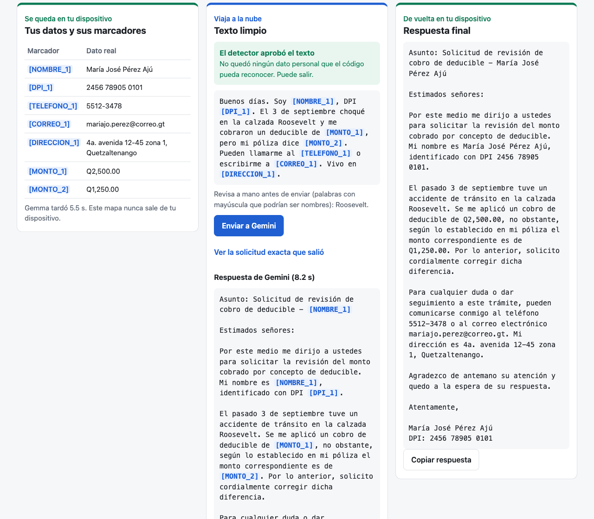
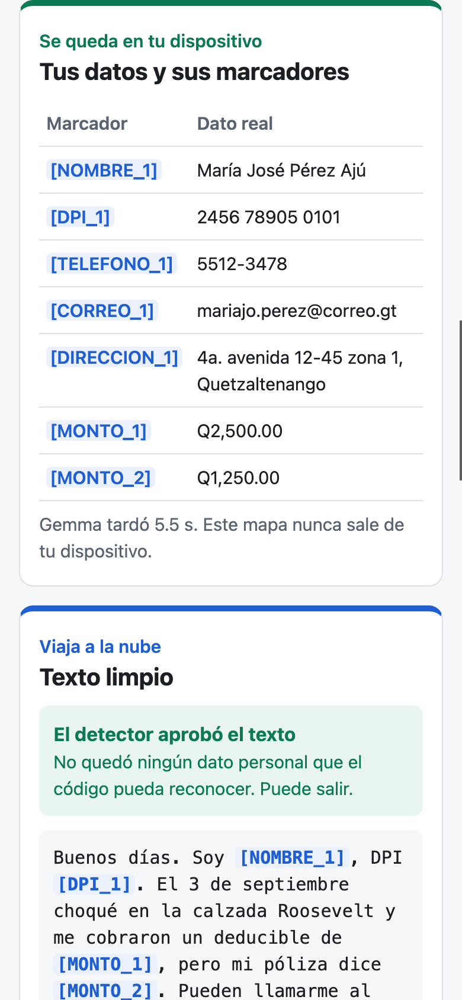
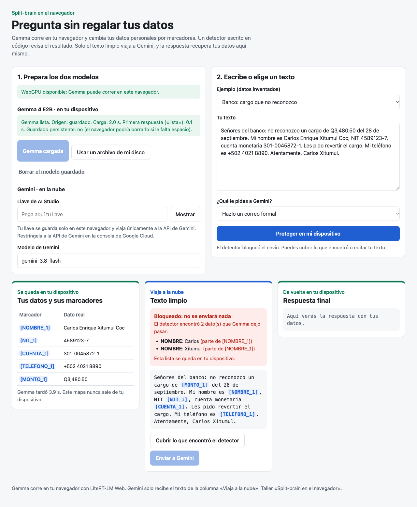

## Qué vas a construir | 5

Una página que te deja pedirle ayuda a Gemini con un correo para tu banco o tu aseguradora **sin enviarle tus datos personales**. Todo pasa en tres etapas que ves en pantalla:

1. **Se queda en tu dispositivo.** Gemma 4 E2B corre dentro de Chrome (WebGPU) y encuentra nombres, DPI, NIT, teléfonos, correos, direcciones, cuentas y montos. El código los cambia por marcadores como `[NOMBRE_1]` y guarda el mapa en la página.
2. **Viaja a la nube.** Un detector escrito en JavaScript revisa el texto limpio. Si queda un solo dato que pueda reconocer, bloquea el envío. Solo si aprueba, el texto limpio va a Gemini.
3. **De vuelta en tu dispositivo.** La respuesta de Gemini llega con marcadores y la página los cambia por tus datos reales. Gemini nunca los vio.

Pruébala en línea: [codelab-gemma-navegador-z63pqhhmxq-uc.a.run.app](https://codelab-gemma-navegador-z63pqhhmxq-uc.a.run.app). Gemma corre en tu navegador y usas tu propia llave; el servidor solo entrega archivos estáticos.



En el teléfono las tres etapas se apilan:



**Qué aprenderás**

- Correr Gemma 4 E2B en el navegador con LiteRT-LM Web y guardar el modelo de 2 GB en el almacenamiento privado del navegador para descargarlo una sola vez.
- Usar un modelo pequeño local para encontrar datos personales y convertirlos en marcadores.
- Poner la frontera de privacidad en código: un detector determinista que bloquea el envío si algo se escapó.
- Llamar a la API de Gemini desde el navegador solo con texto limpio y restaurar los datos en el dispositivo.

## Antes de empezar | 10

**Necesitas**

- Una computadora con **Chrome o Edge recientes** con WebGPU, unos **3 GB libres** en disco y buena conexión para descargar el modelo una vez (2.0 GB). Probamos el taller en una MacBook Pro M1 Max con 64 GB de memoria, macOS 26 y Chrome 154. Con Gemma cargada, los procesos de Chrome pasaron de 1.0 a 3.5 GB de memoria (medido con `ps`). No lo probamos en equipos con menos memoria.
- **Python 3** para servir la página (`python3 servir.py`) y **Node.js 20 o más reciente** para las pruebas (`node --test`). Usamos Python 3.14 y Node 24.
- Una **llave de la API de Gemini** de AI Studio.

**Cuánto tarda y cuánto cuesta.** Unos 80 minutos. Cuesta Q0: Gemma corre en tu computadora y Gemini se usa con la capa gratuita de AI Studio. Todo el taller hace unas 10 llamadas a Gemini.

:::info ¿Y en el teléfono?
La página se ve y se usa bien en un teléfono, pero Gemma necesita WebGPU y cargar 2 GB en la memoria de la GPU. Según la tabla de implementación de WebGPU, Chrome para Android lo trae desde la versión 121 en Android 12 o superior con GPU ARM o Qualcomm, y Safari lo trae activado desde iOS 26. **No probamos la carga del modelo en un teléfono**: haz el taller en una laptop.
:::

**Consigue tu llave de Gemini**

1. Entra a [aistudio.google.com/apikey](https://aistudio.google.com/apikey) con tu cuenta de Google.
2. Pulsa **Create API key** y elige o crea un proyecto.
3. Copia la llave. La vas a pegar en la página en el paso 6; no la pongas en ningún archivo.

Tu cuota real está en [aistudio.google.com/rate-limit](https://aistudio.google.com/rate-limit). La capa gratuita es pequeña. Si te quedas sin cuota, cambia el campo **Modelo de Gemini** de la página a `gemini-3.5-flash-lite` (lo probamos con una llave de AI Studio).

:::warn Protege tu llave
La página guarda la llave solo en tu navegador (`localStorage`) y la envía únicamente a `generativelanguage.googleapis.com`, en el encabezado `x-goog-api-key`. Aun así, en la [consola de Google Cloud](https://console.cloud.google.com/apis/credentials) abre tu llave y, en **Restricciones de API**, deja solo **Generative Language API**: si alguien la copia, no podrá usarla con otros servicios. La consola también ofrece restringirla por sitio web; no lo probamos en este taller.
:::

**Descarga el código y sirve la página**

```bash
git clone https://github.com/ykro/codelabs-2027
cd codelabs-2027/gemma-en-el-navegador/inicio
python3 servir.py
```

```salida
Sirviendo en http://localhost:8000 (Ctrl+C para detener)
```

Si no usas git, descarga el zip desde [github.com/ykro/codelabs-2027](https://github.com/ykro/codelabs-2027) (botón **Code → Download ZIP**) y entra a la misma carpeta.

`servir.py` es un servidor de Python de 14 líneas que le dice a Chrome que no guarde copias (`Cache-Control: no-store`). Así cada recarga usa la última versión de tus archivos; con `python3 -m http.server`, Chrome puede seguir usando la versión vieja de un módulo aunque recargues.

Abre [http://localhost:8000](http://localhost:8000) en Chrome. WebGPU solo funciona en un contexto seguro: `localhost` cuenta como seguro, abrir el archivo con doble clic (`file://`) no.

La carpeta `inicio/` ya trae la interfaz (`index.html`, `estilo.css`, `js/app.js`), los textos de ejemplo (`js/ejemplos.js`), utilidades de texto (`js/texto.js`), el servidor (`servir.py`) y las pruebas (`pruebas/`). Tú escribes cinco archivos, uno por paso: `modelo.js`, `anonimizador.js`, `detector.js`, `gemini.js` y `restaurar.js`. Cada uno trae un `TODO`; en cada paso **reemplazas todo el contenido** del archivo con el código del paso.

:::check Comprueba
La página abre y dice:

```salida
WebGPU disponible: Gemma puede correr en este navegador.
Completa el paso 3 (js/modelo.js) para cargar Gemma.
```
:::

## Gemma en tu navegador | 15

Usas **LiteRT-LM Web** (`@litert-lm/core`), la librería de Google para correr modelos de lenguaje en el navegador con WebGPU. Es una vista previa: por ahora solo acepta los modelos `-web.litertlm` de Gemma 4. La importas desde jsDelivr con la versión fija, sin instalar nada ni compilar.

:::info ¿Por qué LiteRT-LM y no MediaPipe?
El mismo repositorio publica `gemma-4-E2B-it-web.task` para MediaPipe LLM Inference, pero esa librería está en mantenimiento y sus responsables recomiendan migrar a LiteRT-LM (issue google-ai-edge/mediapipe#6270, con un fallo «memory access out of bounds» al cargar Gemma 4 en Chrome sobre macOS). LiteRT-LM Web 0.18.0 cargó y respondió en todas nuestras pruebas, así que no seguimos con MediaPipe.
:::

El modelo es `gemma-4-E2B-it-web.litertlm` de [litert-community/gemma-4-E2B-it-litert-lm](https://huggingface.co/litert-community/gemma-4-E2B-it-litert-lm): 2.0 GB, solo texto, licencia Apache 2.0. No necesitas cuenta de Hugging Face ni aceptar una licencia, y Hugging Face permite descargarlo desde otra página (CORS).

Para no descargar 2 GB cada vez, el código lo guarda en el **Origin Private File System (OPFS)**: un disco privado que Chrome le da a cada sitio. Y como 2 GB pueden cortarse a medio camino, la descarga es **reanudable**:

- **Partes de 32 MB.** Cada parte es un archivo en OPFS que se escribe con `createWritable()` y solo existe cuando se cierra entera. Si cierras la pestaña o se cae la red, pierdes como mucho una parte.
- **Un registro.** `gemma-4-E2B-it-web.json` guarda el tamaño total, el `ETag` del archivo y si ya está completo.
- **Pide solo lo que falta.** Al volver, cuenta las partes guardadas y pide el resto con el encabezado `Range: bytes=<n>-`. Hugging Face redirige a su CDN, que responde `206 Partial Content` con `Content-Range`. Si el servidor responde `200` (el archivo entero) o el `ETag` cambió, borra lo guardado, empieza de cero y la página lo dice.
- **Valida al final.** Suma el tamaño de las partes; solo si da el total marca el modelo como completo. No calcula el SHA-256: WebCrypto no lo hace por partes y habría que tener los 2 GB en memoria.
- **Pide que no lo borren.** `navigator.storage.persist()` le pide a Chrome que no borre el modelo cuando le falte espacio.

`new Blob(partes)` une las partes sin copiarlas, y `Engine.create` acepta ese `Blob` y lo lee por partes hacia la GPU.

Reemplaza todo el contenido de `js/modelo.js`:

```javascript
// archivo: js/modelo.js
// Gemma 4 E2B en tu navegador con LiteRT-LM Web (WebGPU).
// El archivo (2 GB) se descarga una vez, por partes, al almacenamiento privado del
// navegador (OPFS). Si la descarga se corta, la siguiente vez pide solo lo que falta.
import { Engine } from 'https://cdn.jsdelivr.net/npm/@litert-lm/core@0.18.0/+esm';

export const MODELO_URL =
  'https://huggingface.co/litert-community/gemma-4-E2B-it-litert-lm/resolve/main/gemma-4-E2B-it-web.litertlm';
const PREFIJO = 'gemma-4-E2B-it-web';
const PARTE = 32 * 1024 * 1024; // 32 MB por archivo: si se corta, se pierde como mucho una parte
const nombreParte = (i) => `${PREFIJO}.parte-${String(i).padStart(4, '0')}`;

const carpeta = () => navigator.storage.getDirectory();

async function leerInfo() {
  try {
    const archivo = await (await (await carpeta()).getFileHandle(`${PREFIJO}.json`)).getFile();
    return JSON.parse(await archivo.text());
  } catch {
    return null;
  }
}

async function guardarInfo(info) {
  const escritor = await (await (await carpeta()).getFileHandle(`${PREFIJO}.json`, { create: true })).createWritable();
  await escritor.write(JSON.stringify(info));
  await escritor.close();
}

// Partes completas guardadas, en orden. Una parte solo existe si se cerró entera.
async function partesGuardadas() {
  const dir = await carpeta();
  const partes = [];
  for (let i = 0; ; i++) {
    try {
      partes.push(await (await dir.getFileHandle(nombreParte(i))).getFile());
    } catch {
      return partes;
    }
  }
}

// { completo, guardados, total }: lo que la página muestra antes de cargar.
export async function estadoDescarga() {
  const info = await leerInfo();
  const guardados = (await partesGuardadas()).reduce((suma, parte) => suma + parte.size, 0);
  return { completo: Boolean(info?.completo && guardados === info.total), guardados, total: info?.total ?? 0 };
}

async function escribirParte(i, trozos) {
  const escritor = await (await (await carpeta()).getFileHandle(nombreParte(i), { create: true })).createWritable();
  await escritor.write(new Blob(trozos));
  await escritor.close(); // hasta aquí la parte no existe: un corte nunca deja una parte a medias
}

async function descargar(alAvanzar) {
  let info = await leerInfo();
  let partes = (await partesGuardadas()).filter((p) => p.size === PARTE);
  let desde = partes.length * PARTE;
  const respuesta = await fetch(MODELO_URL, desde ? { headers: { Range: `bytes=${desde}-` } } : {});
  const etag = respuesta.headers.get('etag');
  let continua = respuesta.status === 206;
  // Solo se continúa si el servidor mandó el resto (206) del mismo archivo (mismo ETag).
  if (desde && (!continua || (info?.etag && etag !== info.etag))) {
    await borrarModelo();
    if (respuesta.status === 206) {
      await respuesta.body.cancel(); // el archivo cambió en el servidor: de cero
      return descargar(alAvanzar);
    }
    desde = 0;
    continua = false;
  }
  if (!respuesta.ok) throw new Error(`No se pudo descargar el modelo (HTTP ${respuesta.status}).`);
  const rango = respuesta.headers.get('content-range'); // «bytes 1000-2008432639/2008432640»
  const total = rango ? Number(rango.split('/')[1]) : Number(respuesta.headers.get('content-length'));
  info = { url: MODELO_URL, total, etag, completo: false };
  await guardarInfo(info);

  let indice = desde / PARTE;
  let recibidos = desde;
  let trozos = [];
  let enMemoria = 0;
  const lector = respuesta.body.getReader();
  alAvanzar?.({ recibidos, total, continua, reinicio: Boolean(desde === 0 && partes.length) });
  for (;;) {
    const { done, value } = await lector.read();
    if (value) {
      trozos.push(value);
      enMemoria += value.length;
      recibidos += value.length;
    }
    while (enMemoria >= PARTE || (done && enMemoria > 0)) {
      const todo = new Blob(trozos);
      const largo = Math.min(PARTE, enMemoria);
      await escribirParte(indice++, [todo.slice(0, largo)]);
      trozos = [todo.slice(largo)];
      enMemoria -= largo;
    }
    alAvanzar?.({ recibidos, total, continua });
    if (done) break;
  }
  partes = await partesGuardadas();
  const guardados = partes.reduce((suma, parte) => suma + parte.size, 0);
  if (guardados !== total) throw new Error(`La descarga quedó incompleta (${guardados} de ${total} bytes). Vuelve a intentar.`);
  await guardarInfo({ ...info, completo: true });
  return new Blob(partes); // las partes se leen en orden, sin copiarlas a memoria
}

export async function modeloGuardado() {
  const estado = await estadoDescarga();
  return estado.completo ? new Blob(await partesGuardadas()) : null;
}

// archivo: un File elegido desde el disco (opcional). Si no hay, usa el guardado o lo descarga.
export async function cargarGemma({ archivo, alAvanzar } = {}) {
  if (!('gpu' in navigator)) throw new Error('Este navegador no tiene WebGPU.');
  const persistente = (await navigator.storage.persist?.()) ?? false; // que el navegador no lo borre
  let modelo = archivo ?? (await modeloGuardado());
  const origen = archivo ? 'disco' : modelo ? 'guardado' : 'descarga';
  if (!modelo) modelo = await descargar(alAvanzar);
  const engine = await Engine.create({ model: modelo, mainExecutorSettings: { maxNumTokens: 4096 } });
  return { engine, origen, persistente };
}

export async function borrarModelo() {
  const dir = await carpeta();
  const nombres = [];
  for await (const nombre of dir.keys()) if (nombre.startsWith(PREFIJO)) nombres.push(nombre);
  for (const nombre of nombres) await dir.removeEntry(nombre);
}
```

Recarga la página y pulsa **Descargar y cargar Gemma**. Verás el avance de la descarga:

```salida
Se descarga una sola vez (2 GB) y queda guardado en este navegador.

Descargando: 0.00 de 2.01 GB (0.5 s)
Descargando: 0.31 de 2.01 GB (20.6 s)
Descargando: 0.80 de 2.01 GB (40.4 s)
Descargando: 1.00 de 2.01 GB (48.7 s)
```

Cuando vaya por la mitad, **cierra la pestaña** para comprobar que la descarga se reanuda. Abre otra vez [http://localhost:8000](http://localhost:8000):

```salida
Descarga a medias: 0.97 de 2.01 GB guardados. Pulsa el botón para continuar donde quedó.

Botón: Continuar la descarga
```

Pulsa **Continuar la descarga**. Sigue desde lo guardado, no desde cero:

```salida
Descargando: 0.97 de 2.01 GB (0.4 s) · continúa donde quedó
Descargando: 1.44 de 2.01 GB (20.5 s) · continúa donde quedó
Descargando: 1.86 de 2.01 GB (40.6 s) · continúa donde quedó
```

Al terminar, la página le pide a Gemma una palabra para comprobar que responde:

```salida
Gemma lista. Origen: descarga. Carga: 49.3 s. Primera respuesta («lista»): 0.1 s. Guardado persistente: no (el navegador podría borrarlo si le falta espacio).
```

:::info La primera vez en tu computadora puede tardar más
En algunas de nuestras corridas la primera respuesta de Gemma tardó entre 28 y 38 s; en la mayoría, menos de un segundo. No encontramos un patrón fijo (pasó con el modelo recién descargado, con el modelo guardado y con el archivo cargado desde el disco). Si la tarjeta se queda en «Calentando…», espera.
:::

Recarga la página y pulsa **Cargar Gemma**. Ya no descarga nada:

```salida
Ya está guardado en este navegador (2.01 GB). Se carga sin descargar.

Gemma lista. Origen: guardado. Carga: 2.0 s. Primera respuesta («lista»): 0.1 s. Guardado persistente: no (el navegador podría borrarlo si le falta espacio).
```

:::info Dónde quedó el modelo
Abre la consola de DevTools (Cmd+Opción+J en Mac, Ctrl+Mayús+J en Windows) y escribe:

```javascript
(await navigator.storage.estimate()).usage / 1e9
```

```salida
2.0084453
```

Son los gigabytes que este sitio guarda en tu navegador. El botón **Borrar el modelo guardado** los libera.
:::

:::check Comprueba
La tarjeta de Gemma está en verde y dice «Gemma lista». Si recargas, el origen es «guardado» y carga en segundos.
:::

## Gemma encuentra los datos | 10

Un modelo de 2 mil millones de parámetros puede reescribir mal un texto largo: cambiar una palabra, omitir una frase. Por eso no le pides que reescriba. Le pides una **lista** de los datos que encontró, en JSON. La respuesta es corta (se genera rápido) y el código hace el reemplazo, siempre igual.

Tres decisiones del código:

- **Una conversación nueva por texto** y muestreo `GREEDY`: el mismo texto da siempre la misma lista.
- **`leerDatos`** toma de la primera `{` a la última `}`, porque Gemma a veces envuelve el JSON en ```` ```json ````.
- **`armarMapa`** solo acepta valores que de verdad están en el texto (si Gemma inventa o cambia uno, se ignora) y reemplaza primero los más largos, para que «Marta Pop de León» no quede como «[NOMBRE_1] Pop de León».

Reemplaza todo el contenido de `js/anonimizador.js`:

```javascript
// archivo: js/anonimizador.js
// Gemma encuentra los datos personales; el código arma el mapa y los reemplaza.
import { contiene, nuevoMarcador, plano, reemplazar } from './texto.js';

export const TIPOS = ['NOMBRE', 'DPI', 'NIT', 'TELEFONO', 'CORREO', 'DIRECCION', 'CUENTA', 'MONTO'];

const INSTRUCCIONES = `Eres un anonimizador. Lee el texto y lista TODOS los datos personales que aparecen: nombres y apellidos de personas, DPI, NIT, teléfonos, correos, direcciones, números de cuenta o póliza, y montos de dinero.
Responde solo con JSON, sin explicaciones, con esta forma:
{"datos":[{"tipo":"NOMBRE","valor":"..."}]}
Tipos permitidos: ${TIPOS.join(', ')}.
Copia cada valor exactamente como aparece en el texto. Incluye a todas las personas mencionadas (familiares, médicos, quien firma), aunque aparezcan solo con un nombre o un apellido. Si una persona aparece escrita de formas distintas, incluye cada forma. Incluye todos los montos.`;

// Corre en el navegador: una conversación nueva por texto, sin historial.
export async function buscarDatos(engine, texto) {
  const conversacion = await engine.createConversation({
    preface: { messages: [{ role: 'system', content: INSTRUCCIONES }] },
    // type 3 = GREEDY: el mismo texto da siempre la misma respuesta.
    sessionConfig: { maxOutputTokens: 1024, samplerParams: { type: 3 } },
  });
  try {
    const respuesta = await conversacion.sendMessage(texto);
    return leerDatos(respuesta.content.map((parte) => parte.text ?? '').join(''));
  } finally {
    await conversacion.delete();
  }
}

// Gemma a veces envuelve el JSON en ```json ... ```: tomamos de la primera { a la última }.
export function leerDatos(salida) {
  const inicio = salida.indexOf('{');
  const fin = salida.lastIndexOf('}');
  if (inicio < 0 || fin < inicio) throw new Error('Gemma no devolvió JSON.');
  const { datos } = JSON.parse(salida.slice(inicio, fin + 1));
  if (!Array.isArray(datos)) throw new Error('El JSON de Gemma no trae la lista "datos".');
  return datos;
}

// Convierte la lista de Gemma en { texto, mapa, ignorados }.
// Solo se usan valores que de verdad están en el texto: si Gemma inventa o
// cambia un valor, se ignora y el detector revisará lo que haya quedado.
export function armarMapa(texto, datos) {
  const mapa = {};
  const ignorados = [];
  const vistos = new Set();
  for (const { tipo, valor } of datos) {
    if (typeof valor !== 'string' || !valor.trim()) continue;
    const clave = plano(valor.trim());
    if (vistos.has(clave)) continue;
    if (!contiene(texto, valor)) {
      ignorados.push(valor);
      continue;
    }
    vistos.add(clave);
    mapa[nuevoMarcador(TIPOS.includes(tipo) ? tipo : 'DATO', mapa)] = valor.trim();
  }
  // Primero los valores largos: «Marta Pop de León» antes que «Marta».
  let limpio = texto;
  for (const [marcador, valor] of Object.entries(mapa).sort((a, b) => b[1].length - a[1].length)) {
    limpio = reemplazar(limpio, valor, marcador);
  }
  return { texto: limpio, mapa, ignorados };
}
```

En otra terminal, en la misma carpeta `inicio`, corre las pruebas de este paso:

```bash
node --test pruebas/anonimizador.test.js
```

```salida
✔ leerDatos acepta el JSON envuelto en ```json (0.889416ms)
✔ armarMapa reemplaza primero los valores largos e ignora lo que no está en el texto (2.101333ms)
ℹ tests 2
ℹ suites 0
ℹ pass 2
ℹ fail 0
ℹ cancelled 0
ℹ skipped 0
ℹ todo 0
ℹ duration_ms 53.159917
```

Recarga la página, carga Gemma y pulsa **Proteger en mi dispositivo** con el primer ejemplo. La columna «Se queda en tu dispositivo» muestra el mapa:

```salida
[NOMBRE_1]     María José Pérez Ajú
[DPI_1]        2456 78905 0101
[TELEFONO_1]   5512-3478
[CORREO_1]     mariajo.perez@correo.gt
[DIRECCION_1]  4a. avenida 12-45 zona 1, Quetzaltenango
[MONTO_1]      Q2,500.00
[MONTO_2]      Q1,250.00
Gemma tardó 5.3 s. Este mapa nunca sale de tu dispositivo.
```

La columna «Viaja a la nube» muestra el texto limpio y un aviso en rojo: «Completa el paso 5 (js/detector.js): sin detector no se envía nada.». Sin detector, el botón **Enviar a Gemini** sigue apagado.

:::check Comprueba
`node --test pruebas/anonimizador.test.js` pasa y el mapa del primer ejemplo tiene 7 filas.
:::

## El código decide la frontera | 12

Este es el centro del taller. Un prompt no es una frontera de seguridad: si le pides a un modelo «no envíes el DPI», el DPI ya viajó cuando el modelo lee la instrucción. Y Gemma es probabilística: a veces no ve un dato. La frontera la decide **código determinista** que revisa el texto exacto que va a salir.

El detector hace tres revisiones:

1. **Formatos**: correo, DPI de 13 dígitos (con su dígito verificador), NIT con guion, teléfono de Guatemala de 8 dígitos (con o sin +502), montos en quetzales, direcciones con calle o avenida, cualquier número de 6 dígitos o más y una palabra con mayúscula después de un título («Dr. Ramírez», «don Julio»).
2. **Valores del mapa** que siguen en el texto, sin importar tildes ni mayúsculas.
3. **Partes de un nombre conocido**: si el mapa tiene «Carlos Enrique Xitumul Coc» y el texto todavía dice «Carlos Xitumul», bloquea.

Si encuentra algo, `ok` es `false` y no se envía nada (*fail-closed*). `cubrirFugas` le permite a la persona tapar lo encontrado con marcadores nuevos y volver a revisar. `revisarAMano` señala palabras con mayúscula en medio de una oración: el código no puede saber si «Sofía» es un nombre, pero puede pedirle a la persona que lo mire. Esa lista no bloquea.

Reemplaza todo el contenido de `js/detector.js`:

```javascript
// archivo: js/detector.js
// La frontera de privacidad es código, no un prompt: revisa el texto que va a
// salir hacia la nube y devuelve cada dato personal que todavía encuentre.
import { contiene, nuevoMarcador, plano, reemplazar } from './texto.js';

// Formatos que se pueden verificar sin un modelo. El orden importa:
// un DPI se marca antes de que la regla de teléfono vea sus dígitos.
const PATRONES = [
  { tipo: 'CORREO', motivo: 'formato de correo', regex: /[\p{L}\p{N}._%+-]+@[\p{L}\p{N}-]+(?:\.[\p{L}\p{N}-]+)+/gu },
  { tipo: 'DPI', motivo: '13 dígitos seguidos', regex: /(?<!\d)\d{4}[ -]?\d{5}[ -]?\d{4}(?!\d)/g },
  { tipo: 'NIT', motivo: 'formato de NIT', regex: /(?<![\d-])\d{4,8}-[\dkK](?![\p{L}\p{N}])/gu },
  { tipo: 'TELEFONO', motivo: 'teléfono de 8 dígitos', regex: /(?<!\d)(?:\+?502[ -]?)?[2-7]\d{3}[ -]?\d{4}(?!\d)/g },
  { tipo: 'MONTO', motivo: 'monto en quetzales', regex: /(?<!\p{L})Q\.? ?\d[\d,]*(?:\.\d+)?|\d[\d,]*(?:\.\d+)? ?quetzales/giu },
  { tipo: 'DIRECCION', motivo: 'calle o avenida con número', regex: /(?:calle|avenida|av\.|calzada|diagonal) +\d{1,3}-\d{1,3}/giu },
  { tipo: 'NUMERO', motivo: 'número de 6 dígitos o más', regex: /\d{6,}/g },
  // Una palabra con mayúscula después de un título casi siempre es un nombre: «Dr. Ramírez», «don Julio».
  { tipo: 'NOMBRE', motivo: 'nombre después de un título', regex: /(?<=\b(?:[Dd]on|[Dd]oña|Dra?|Lic|Licda|Ing|Sra?|Srta)\.? )\p{Lu}\p{Ll}+/gu },
];
const TITULOS = new Set(['Don', 'Doña', 'Dr', 'Dra', 'Lic', 'Licda', 'Ing', 'Sr', 'Sra', 'Srta']);

// Palabras de un nombre que no identifican a nadie por sí solas.
const CONECTORES = new Set(['de', 'del', 'la', 'las', 'los', 'y', 'don', 'dona', 'dr', 'dra', 'sr', 'sra', 'lic', 'licda']);

// Dígito verificador del DPI (CUI) de Guatemala: 8 dígitos, verificador,
// departamento (01-22) y municipio.
const MUNICIPIOS = [17, 8, 16, 16, 13, 14, 19, 8, 24, 21, 9, 30, 32, 21, 8, 17, 14, 5, 11, 11, 7, 17];
export function dpiValido(valor) {
  const cui = valor.replace(/\D/g, '');
  if (cui.length !== 13) return false;
  const depto = Number(cui.slice(9, 11));
  const muni = Number(cui.slice(11, 13));
  if (depto < 1 || depto > 22 || muni < 1 || muni > MUNICIPIOS[depto - 1]) return false;
  const suma = [...cui.slice(0, 8)].reduce((total, d, i) => total + Number(d) * (i + 2), 0);
  return suma % 11 === Number(cui[8]);
}

export function buscarFugas(texto, mapa = {}) {
  const fugas = [];
  const vistos = new Set();
  const agregar = (fuga) => {
    const clave = plano(fuga.valor);
    if (vistos.has(clave)) return;
    vistos.add(clave);
    fugas.push(fuga);
  };

  // 1. Formatos conocidos. Lo que coincide se tapa para no contarlo dos veces.
  let resto = texto;
  for (const { tipo, motivo, regex } of PATRONES) {
    resto = resto.replace(regex, (valor) => {
      agregar({ tipo, valor, motivo: tipo === 'DPI' && dpiValido(valor) ? 'DPI con dígito verificador válido' : motivo });
      return '#'.repeat(valor.length);
    });
  }

  // 2. Valores originales del mapa que siguen en el texto.
  for (const [marcador, valor] of Object.entries(mapa)) {
    if (contiene(texto, valor)) agregar({ tipo: marcador.slice(1, marcador.lastIndexOf('_')), valor, marcador, motivo: `valor original de ${marcador}` });
  }

  // 3. Partes de un nombre conocido: «Carlos Xitumul» cuando el mapa tiene «Carlos Enrique Xitumul Coc».
  for (const [marcador, valor] of Object.entries(mapa)) {
    if (!marcador.startsWith('[NOMBRE_')) continue;
    for (const parte of valor.split(/[\s.,]+/)) {
      if (parte.length < 3 || CONECTORES.has(plano(parte))) continue;
      if (contiene(texto, parte)) agregar({ tipo: 'NOMBRE', valor: parte, motivo: `parte de ${marcador}` });
    }
  }

  return { ok: fugas.length === 0, fugas };
}

// Tapa lo que encontró el detector con marcadores nuevos (o el que ya tenía ese valor).
export function cubrirFugas(texto, mapa, fugas) {
  const nuevoMapa = { ...mapa };
  let nuevoTexto = texto;
  for (const fuga of fugas) {
    const marcador = fuga.marcador ?? nuevoMarcador(fuga.tipo, nuevoMapa);
    nuevoMapa[marcador] = fuga.valor;
    nuevoTexto = reemplazar(nuevoTexto, fuga.valor, marcador).split(fuga.valor).join(marcador);
  }
  return { texto: nuevoTexto, mapa: nuevoMapa };
}

// Lo que el código no puede saber: una palabra con mayúscula en medio de una
// oración puede ser un nombre que Gemma no vio. No bloquea; la persona decide.
export function revisarAMano(texto) {
  const palabras = [...texto.matchAll(/(?<=[\p{L}\p{N},;)\]] )\p{Lu}\p{Ll}+/gu)].map((m) => m[0]);
  return [...new Set(palabras.filter((p) => !TITULOS.has(p)))];
}
```

:::info El dígito verificador del DPI
Los primeros 8 dígitos del DPI, multiplicados por 2, 3, 4… 9 y sumados, dan como residuo de dividir entre 11 el noveno dígito. Los últimos cuatro son el departamento (01–22) y el municipio. `dpiValido` no decide si se bloquea (cualquier número de 13 dígitos se bloquea); sirve para explicar el motivo.
:::

Corre las pruebas del detector:

```bash
node --test pruebas/detector.test.js
```

```salida
✔ dpiValido acepta un DPI con dígito verificador correcto y rechaza uno alterado (1.111ms)
✔ detecta cada formato de dato personal (1.955458ms)
✔ un título seguido de un marcador no es una fuga (0.07425ms)
✔ el DPI se reporta una vez, no también como teléfono (0.07575ms)
✔ no confunde fechas, horas ni números cortos con datos (0.069208ms)
✔ cada texto de ejemplo sin proteger tiene fugas (0.208917ms)
✔ el texto limpio con marcadores pasa (1.945542ms)
✔ bloquea un valor del mapa que siguió en el texto, sin importar tildes ni mayúsculas (1.009667ms)
✔ bloquea partes de un nombre conocido: la firma «Carlos Xitumul» (2.124833ms)
✔ una parte de nombre corta no coincide dentro de otra palabra (0.948791ms)
✔ revisarAMano señala nombres que el código no puede reconocer (0.707292ms)
ℹ tests 11
ℹ suites 0
ℹ pass 11
ℹ fail 0
ℹ cancelled 0
ℹ skipped 0
ℹ todo 0
ℹ duration_ms 63.393459
```

Recarga, carga Gemma y protege el primer ejemplo. Ahora el detector aprueba:

```salida
El detector aprobó el texto
No quedó ningún dato personal que el código pueda reconocer. Puede salir.

Revisa a mano antes de enviar (palabras con mayúscula que podrían ser nombres): Roosevelt.
```

Elige el ejemplo **Banco: cargo que no reconozco** y protégelo. Gemma encontró el nombre completo, pero no la firma del final, y el detector lo bloquea:

```salida
Bloqueado: no se enviará nada
El detector encontró 2 dato(s) que Gemma dejó pasar:
NOMBRE: Carlos (parte de [NOMBRE_1])
NOMBRE: Xitumul (parte de [NOMBRE_1])
Esta lista se queda en tu dispositivo.

Señores del banco: no reconozco un cargo de [MONTO_1] del 28 de septiembre. Mi nombre es [NOMBRE_1], NIT [NIT_1], cuenta monetaria [CUENTA_1]. Les pido revertir el cargo. Mi teléfono es [TELEFONO_1]. Atentamente, Carlos Xitumul.
```



Pulsa **Cubrir lo que encontró el detector**. Los dos nombres se vuelven `[NOMBRE_2]` y `[NOMBRE_3]`, el detector vuelve a revisar y aprueba.

:::check Comprueba
Las pruebas pasan, el primer ejemplo sale aprobado y el del banco sale bloqueado hasta que lo cubres.
:::

## Solo el texto limpio viaja a Gemini | 8

`preguntarAGemini` es la **única función que habla con la nube**. Antes de abrir la conexión vuelve a pasar el detector sobre el texto exacto que va a enviar: aunque un error en la interfaz llamara a esta función con el texto original, no saldría nada. La llave va en el encabezado `x-goog-api-key`, no en la URL, para que no quede en historiales ni registros.

La llamada es REST directo a `generateContent`, sin SDK. La instrucción de sistema le pide a Gemini copiar los marcadores tal cual y no inventar datos.

Reemplaza todo el contenido de `js/gemini.js`:

```javascript
// archivo: js/gemini.js
// La única función que habla con la nube. Antes de abrir la conexión vuelve a
// pasar el detector sobre el texto exacto que va a enviar: si hay una fuga, no sale nada.
import { buscarFugas } from './detector.js';

export const TAREAS = {
  formal: 'Reescribe este mensaje como un correo formal, claro y breve, listo para enviar.',
  pedir: 'Resume el caso en tres puntos y dime qué debo pedir y qué documentos preparar.',
};

const INSTRUCCIONES = 'Los datos personales vienen como marcadores entre corchetes, por ejemplo [NOMBRE_1] o [DPI_1]. Copia cada marcador exactamente igual donde lo necesites. No inventes datos ni marcadores nuevos. Responde en español de Guatemala, en texto simple sin formato Markdown.';

export function armarSolicitud(tarea, texto) {
  return {
    systemInstruction: { parts: [{ text: INSTRUCCIONES }] },
    contents: [{ role: 'user', parts: [{ text: `${TAREAS[tarea]}\n\n${texto}` }] }],
  };
}

export async function preguntarAGemini({ llave, modelo, tarea, texto, mapa }) {
  const revision = buscarFugas(texto, mapa);
  if (!revision.ok) {
    throw new Error(`Bloqueado: el texto todavía tiene ${revision.fugas.length} dato(s) personal(es). No se envió nada.`);
  }
  const url = `https://generativelanguage.googleapis.com/v1beta/models/${encodeURIComponent(modelo)}:generateContent`;
  const respuesta = await fetch(url, {
    method: 'POST',
    headers: { 'Content-Type': 'application/json', 'x-goog-api-key': llave },
    body: JSON.stringify(armarSolicitud(tarea, texto)),
  });
  const datos = await respuesta.json().catch(() => ({}));
  if (respuesta.status === 429) {
    throw new Error('Llegaste al límite de tu cuota gratuita. Espera o cambia el modelo (por ejemplo gemini-3.5-flash-lite).');
  }
  if (!respuesta.ok) throw new Error(datos.error?.message ?? `Gemini respondió HTTP ${respuesta.status}.`);
  return (datos.candidates?.[0]?.content?.parts ?? []).map((parte) => parte.text ?? '').join('').trim();
}
```

Las pruebas usan un `fetch` falso para comprobar que, con una fuga, no se hace ninguna solicitud:

```bash
node --test pruebas/gemini.test.js
```

```salida
✔ con una fuga no hace ninguna solicitud (2.674459ms)
✔ con un valor del mapa todavía en el texto no hace ninguna solicitud (5.195417ms)
✔ con texto limpio envía solo marcadores y la llave va en el encabezado (0.41425ms)
ℹ tests 3
ℹ suites 0
ℹ pass 3
ℹ fail 0
ℹ cancelled 0
ℹ skipped 0
ℹ todo 0
ℹ duration_ms 66.650167
```

:::info La página también limita a dónde puede conectarse
`index.html` trae una política de seguridad de contenido (CSP) que solo permite conexiones a jsDelivr (la librería), Hugging Face (el modelo) y `generativelanguage.googleapis.com`. Si un error intentara mandar datos a otro sitio, Chrome lo bloquearía.
:::

Recarga, carga Gemma, pega tu llave en **Llave de AI Studio**, protege el primer ejemplo y pulsa **Enviar a Gemini**. La respuesta llega con marcadores:

```salida
Respuesta de Gemini (8.4 s)
Asunto: Solicitud de revisión por cobro de deducible - [NOMBRE_1]

Buen día,

Por este medio me comunico con ustedes para solicitar la revisión del deducible aplicado por el accidente ocurrido el pasado 3 de septiembre en la calzada Roosevelt. Se me cobró un monto de [MONTO_1], sin embargo, según lo establecido en mi póliza, la cantidad correspondiente es de [MONTO_2].

Mis datos son los siguientes:
- Nombre: [NOMBRE_1]
- DPI: [DPI_1]
- Dirección: [DIRECCION_1]
- Teléfono: [TELEFONO_1]
- Correo electrónico: [CORREO_1]

Agradezco de antemano su pronta atención a esta solicitud para realizar el ajuste respectivo. Quedo a la espera de su respuesta.

Atentamente,

[NOMBRE_1]
```

Abre **Ver la solicitud exacta que salió**: es todo lo que recibió Gemini. Busca tu nombre, tu DPI o tu teléfono; no están. La columna «Respuesta final» dice «Completa el paso 7 (js/restaurar.js).».

:::check Comprueba
Las pruebas pasan y la respuesta de Gemini solo tiene marcadores, no datos.
:::

## Tus datos vuelven en tu dispositivo | 5

El último paso es el más corto: cambiar cada marcador por su valor. Ocurre en tu navegador, con el mapa que nunca salió. Si Gemini inventó un marcador que no está en el mapa, la página lo deja visible y avisa, en vez de adivinar.

Reemplaza todo el contenido de `js/restaurar.js`:

```javascript
// archivo: js/restaurar.js
// La respuesta de la nube vuelve con marcadores; aquí, en tu dispositivo,
// se cambian por los datos reales. Gemini nunca los vio.
export function restaurar(texto, mapa) {
  let resultado = texto;
  for (const [marcador, valor] of Object.entries(mapa)) {
    resultado = resultado.split(marcador).join(valor);
  }
  // Marcadores que Gemini inventó o cambió: se dejan visibles para que la persona los revise.
  const sinRestaurar = [...new Set(resultado.match(/\[[A-Z]+_\d+\]/g) ?? [])];
  return { texto: resultado, sinRestaurar };
}
```

Corre todas las pruebas:

```bash
node --test
```

```salida
✔ leerDatos acepta el JSON envuelto en ```json (0.933ms)
✔ armarMapa reemplaza primero los valores largos e ignora lo que no está en el texto (2.119708ms)
✔ dpiValido acepta un DPI con dígito verificador correcto y rechaza uno alterado (1.153125ms)
✔ detecta cada formato de dato personal (2.072041ms)
✔ un título seguido de un marcador no es una fuga (0.078125ms)
✔ el DPI se reporta una vez, no también como teléfono (0.076333ms)
✔ no confunde fechas, horas ni números cortos con datos (0.072209ms)
✔ cada texto de ejemplo sin proteger tiene fugas (0.205875ms)
✔ el texto limpio con marcadores pasa (2.46275ms)
✔ bloquea un valor del mapa que siguió en el texto, sin importar tildes ni mayúsculas (1.09975ms)
✔ bloquea partes de un nombre conocido: la firma «Carlos Xitumul» (2.207292ms)
✔ una parte de nombre corta no coincide dentro de otra palabra (1.022417ms)
✔ revisarAMano señala nombres que el código no puede reconocer (0.978083ms)
✔ con una fuga no hace ninguna solicitud (1.9975ms)
✔ con un valor del mapa todavía en el texto no hace ninguna solicitud (3.53925ms)
✔ con texto limpio envía solo marcadores y la llave va en el encabezado (0.387042ms)
✔ cubrirFugas deja el texto aprobado y el mapa puede restaurarlo (6.91775ms)
✔ restaurar devuelve los datos y avisa de marcadores inventados (0.436167ms)
ℹ tests 18
ℹ suites 0
ℹ pass 18
ℹ fail 0
ℹ cancelled 0
ℹ skipped 0
ℹ todo 0
ℹ duration_ms 72.613375
```

Recarga, carga Gemma, protege el primer ejemplo y envíalo. La columna «Respuesta final» tiene tus datos:

```salida
Asunto: Solicitud de revisión de cobro de deducible - María José Pérez Ajú

Estimados señores:

Por este medio me dirijo a ustedes para solicitar la revisión del monto cobrado por concepto de deducible. Mi nombre es María José Pérez Ajú, identificado con DPI 2456 78905 0101.

El pasado 3 de septiembre tuve un accidente de tránsito en la calzada Roosevelt. Se me aplicó un cobro de deducible de Q2,500.00, no obstante, según lo establecido en mi póliza el monto correspondiente es de Q1,250.00. Por lo anterior, solicito cordialmente corregir dicha diferencia.

Para cualquier duda o dar seguimiento a este trámite, pueden comunicarse conmigo al teléfono 5512-3478 o al correo electrónico mariajo.perez@correo.gt. Mi dirección es 4a. avenida 12-45 zona 1, Quetzaltenango.

Agradezco de antemano su atención y quedo a la espera de su respuesta.

Atentamente,

María José Pérez Ajú
DPI: 2456 78905 0101
```

:::check Comprueba
Las 18 pruebas pasan y la respuesta final tiene el nombre, el teléfono y los montos reales.
:::

## Pon a prueba la frontera | 8

Prueba los seis ejemplos. Esto pasó en nuestra corrida (Chrome 154, M1 Max, `gemini-3.8-flash`):

| Ejemplo | Gemma (local) | Detector | Gemini |
|---|---|---|---|
| Aseguradora: deducible mal cobrado | 7 datos en 5.4 s | Aprobó | 8.4 s |
| Banco: cargo que no reconozco | 5 datos en 4.0 s | **Bloqueó** «Carlos» y «Xitumul»; aprobó tras cubrir | 7.4 s |
| Seguro médico: reembolso | 5 datos en 3.6 s | **Bloqueó** «Ramírez»; aprobó tras cubrir | 6.6 s |
| Alquiler: devolución del depósito | 6 datos en 4.5 s | Aprobó | 6.1 s |
| Internet: factura equivocada | 7 datos en 4.8 s | Aprobó | 6.8 s |
| Seguro de vida: trámite familiar | 8 datos en 5.8 s | **Bloqueó** «Julio»; aprobó tras cubrir | 10.2 s |

En los seis casos la solicitud que salió no contenía ningún valor del mapa (lo revisamos en «Ver la solicitud exacta que salió») y la respuesta final no tenía marcadores sin restaurar. En el último ejemplo Gemma partió «Marta Pop de León» en un nombre y una «dirección» («León»): la etiqueta está mal, pero el dato quedó cubierto.

Lo que muestra la tabla:

- **El detector sí hace falta.** En 3 de los 6 ejemplos Gemma dejó pasar un nombre: la firma «Carlos Xitumul», el «Dr. Ramírez» y «Don Julio». El detector bloqueó los tres antes de que salieran; con **Cubrir lo que encontró el detector** quedaron como marcadores nuevos y el texto salió limpio. En una corrida anterior el detector todavía no tenía la regla de títulos y «Dr. Ramírez» sí viajó a Gemini: Gemma no lo listó y la palabra no tenía ningún formato que el código reconociera. Por eso existe esa regla.
- **El detector tiene un límite.** Reconoce formatos y lo que ya está en el mapa. Un nombre que Gemma nunca listó, como un apodo, no tiene formato: el código no puede saber que es un nombre. Para eso está la nota «Revisa a mano», que en el primer ejemplo señala «Roosevelt» (una calzada, no una persona). La persona decide antes de pulsar **Enviar a Gemini**.
- **Gemma es rápida en local.** Cada texto tardó entre 3.6 y 5.8 s en la GPU de la laptop, sin red.

Ahora escribe tu propio texto. Prueba un caso difícil: pon un segundo teléfono en una posdata, firma solo con tu apellido o escribe el DPI sin espacios. Mira qué encuentra Gemma, qué bloquea el detector y qué te pide revisar a mano.

Nosotros probamos este texto:

```text
Buenas, soy Coc. Mi DPI es 2645881340901 y la factura salió por 1,250 quetzales. Si no contesto, llamen a mi cuñado Toño al 4455 6677. PD: mi otro correo es tono.coc@ejemplo.com
```

Gemma (3.1 s) encontró el DPI, el monto, el teléfono y el correo, pero no los nombres sueltos. El detector aprobó, porque «Coc» y «Toño» no tienen un formato que el código reconozca, y la nota de revisión los señaló:

```salida
Buenas, soy Coc. Mi DPI es [DPI_1] y la factura salió por [MONTO_1]. Si no contesto, llamen a mi cuñado Toño al [TELEFONO_1]. PD: mi otro correo es [CORREO_1]

Revisa a mano antes de enviar (palabras con mayúscula que podrían ser nombres): Coc, Toño.
```

Ese es el límite del diseño: lo que se puede verificar con reglas, el código lo bloquea; lo demás, la persona lo ve antes de enviar. Si quieres cubrir esos nombres, edita el texto (por ejemplo, borra la firma) y vuelve a proteger.

:::check Comprueba
Corriste los seis ejemplos, viste al menos un bloqueo y la respuesta final de cada uno tiene tus datos restaurados.
:::

## Problemas comunes | 3

Estos son los errores que encontramos al probar el taller:

**Cambié un archivo y la página sigue diciendo «Completa el paso N».** Nos pasó al servir con `python3 -m http.server`: Chrome reusó la versión vieja del módulo aunque recargamos. Sirve la carpeta con `python3 servir.py`, que manda `Cache-Control: no-store`.

**La página se queda en «Revisando WebGPU…».** La abriste con doble clic (`file://`). La consola muestra:

```salida
Access to script at 'file:///…/js/app.js' from origin 'null' has been blocked by CORS policy: Cross origin requests are only supported for protocol schemes: chrome …
```

Los módulos de JavaScript no cargan desde `file://`. Abre `http://localhost:8000` con `servir.py` corriendo.

**«Este navegador no ofrece WebGPU».** Lo reprodujimos abriendo Chrome sin aceleración por GPU (`--disable-gpu`). Revisa que en `chrome://settings/system` esté activada «Usar la aceleración de gráficos cuando esté disponible» y mira el estado de WebGPU en `chrome://gpu`.

**«API key not valid. Please pass a valid API key.»** La llave tiene un error al copiarla. Vuelve a copiarla desde [aistudio.google.com/apikey](https://aistudio.google.com/apikey).

**«models/gemini-3.8-flash-lite is not found for API version v1beta…»** Ese modelo no existe para la API con llave de AI Studio. Usa `gemini-3.8-flash` o, si te quedaste sin cuota, `gemini-3.5-flash-lite`.

**La descarga se cortó.** Pasa si cierras la pestaña, si la red falla o si la computadora se suspende (en una prueba Chrome cortó la descarga con `net::ERR_NETWORK_IO_SUSPENDED` y la página dijo «No se pudo cargar Gemma (network error)»). No borres nada: vuelve a abrir la página y pulsa **Continuar la descarga**. Lo probamos cerrando la pestaña a la mitad y cortando la conexión: en ambos casos siguió desde las partes guardadas. Si la página dice «el servidor no permitió continuar: empezó de cero», el servidor no aceptó el encabezado `Range` (lo forzamos en una prueba quitándolo); la descarga sigue, pero desde el principio.

**La descarga tarda.** Son 2.0 GB. En nuestras corridas tardó entre 95 y 209 s según la red. Si tu red bloquea Hugging Face, descarga `gemma-4-E2B-it-web.litertlm` desde [la página del modelo](https://huggingface.co/litert-community/gemma-4-E2B-it-litert-lm/tree/main) en otra red y cárgalo con **Usar un archivo de mi disco** (lo probamos en la página publicada). Ese archivo no se guarda en el navegador: tendrás que elegirlo cada vez.

**«Bloqueado: no se enviará nada».** No es un error: es el detector haciendo su trabajo. Pulsa **Cubrir lo que encontró el detector** o edita el texto.

## De este taller a la charla | 2

En la charla «Engineering with Gemma» el mismo patrón corre en Android: Gemma 4 E2B con LiteRT-LM en el teléfono, un `LeakDetector` en Kotlin que revisa el texto antes de abrir la red y la nube que solo ve marcadores. Aquí lo hiciste en el navegador, con la misma regla: **un prompt no es una frontera de seguridad; un proceso que no tiene los bytes, sí**.

Para seguir explorando:

- Cambia a `gemma-4-E4B-it-web.litertlm` (más capaz, más pesado) y compara qué datos encuentra.
- Agrega formatos al detector: placas de vehículo, números de tarjeta con el algoritmo de Luhn.
- Mueve `buscarDatos` a un Web Worker para que la página no se trabe mientras Gemma piensa.
