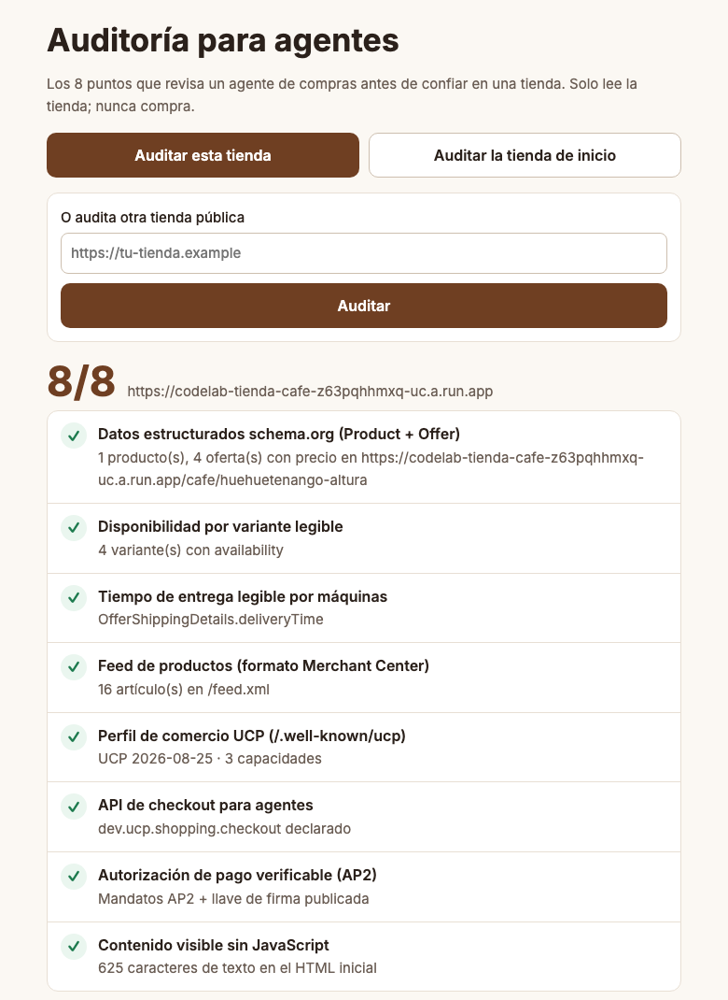
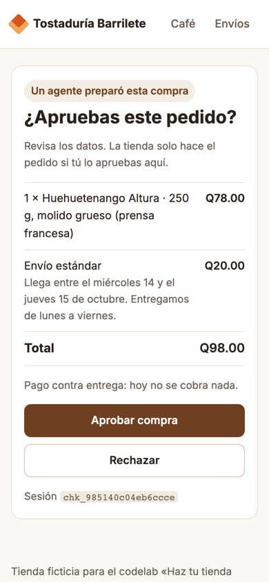
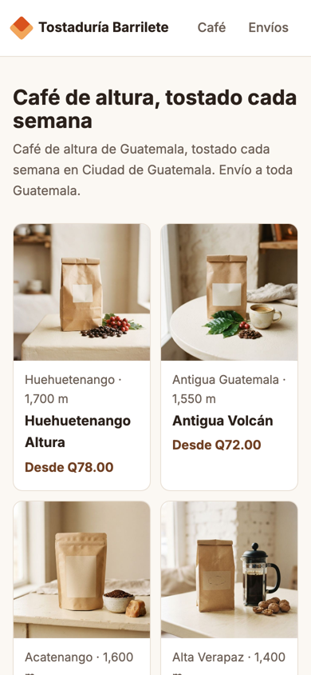

## Qué vas a construir | 3

En la charla, un agente de compras ignora una tienda bonita hecha solo para personas y le compra a la que publica sus datos para máquinas. En este taller tú preparas una tienda así.

Partes de la **Tostaduría Barrilete**, una tienda ficticia de café de Guatemala. Las personas la ven bien en el teléfono, pero un agente no entiende nada: saca **0/8** en la auditoría. Paso a paso la llevas a **8/8**. Al final, un agente de compras ya escrito recibe este encargo:

> «250 g de café de Huehuetenango molido para prensa francesa, menos de Q120, que llegue esta semana»

El agente descubre tu tienda, lee el catálogo, arma la compra y se detiene antes de pagar. Tú la apruebas desde una página de la tienda.





Mira el resultado en línea: [la tienda terminada](https://codelab-tienda-cafe-z63pqhhmxq-uc.a.run.app), su [auditoría](https://codelab-tienda-cafe-z63pqhhmxq-uc.a.run.app/auditoria) y la [tienda de inicio](https://codelab-tienda-cafe-inicio-z63pqhhmxq-uc.a.run.app) para comparar.

Qué vas a aprender:

- Publicar productos, variantes, precios, disponibilidad y tiempos de entrega en JSON-LD de schema.org y en un feed de productos.
- Publicar el perfil de comercio UCP en `/.well-known/ucp` (versión `2026-08-25` de la especificación).
- Abrir una sesión de checkout UCP (`dev.ucp.shopping.checkout`) que el agente puede crear y cambiar, pero no cerrar.
- Firmar cada checkout (extensión AP2 Mandates) y dejar la última palabra a la persona.

:::check Listo si…
Sabes qué vas a construir y abriste la referencia en línea.
:::

## Antes de empezar | 8

Necesitas:

- Una cuenta de Google y un navegador. Nada que instalar en tu computadora.
- [Cloud Shell](https://shell.cloud.google.com/), la terminal en el navegador de Google Cloud. Es gratis con tu cuenta de Google y no pide tarjeta ni facturación; tiene un [límite semanal de uso](https://cloud.google.com/shell/docs/quotas-limits).
- Una llave de la API de Gemini. Solo la usas en el paso 9.

Cuesta Q0. El agente de compras hace **una** llamada a Gemini por compra, dentro de la capa gratuita.

:::info Cómo conseguir la llave de Gemini
1. Entra a [aistudio.google.com/apikey](https://aistudio.google.com/apikey) con tu cuenta de Google.
2. Toca **Create API key** y copia la llave. Guárdala en un lugar privado; no la pegues en archivos del proyecto.
3. Tu cuota real aparece en [aistudio.google.com/rate-limit](https://aistudio.google.com/rate-limit). La capa gratuita de los modelos Flash es pequeña: alcanza para el taller, pero no para cientos de pruebas.
:::

Abre [Cloud Shell](https://shell.cloud.google.com/) y espera a que aparezca la terminal. Descarga el código del taller:

```bash
git clone https://github.com/ykro/codelabs-2027
cd codelabs-2027/tienda-para-agentes/inicio
uv sync
```

Cloud Shell ya trae [uv](https://docs.astral.sh/uv/), el gestor de paquetes de Python. `uv sync` crea el entorno e instala FastAPI, httpx, cryptography y la biblioteca de Gemini:

```salida
Using CPython 3.12.3 interpreter at: /usr/bin/python3
Creating virtual environment at: .venv
Resolved 42 packages in 36ms
…
Prepared 40 packages in 721ms
Installed 40 packages in 30ms
 + annotated-doc==0.0.5
…
 + websockets==16.1.1
```

:::tip Si no usas Cloud Shell
Funciona igual en tu computadora con Python 3.11 o más y uv. También puedes descargar el [zip del repositorio](https://github.com/ykro/codelabs-2027/archive/refs/heads/main.zip).
:::

La carpeta `inicio/` tiene la tienda completa para personas y marcas `TODO paso N` donde vas a escribir:

| Archivo | Qué es |
| --- | --- |
| `app.py` | La tienda (FastAPI): rutas y páginas |
| `catalogo.py` | Productos, variantes, precios y envíos (ya escrito) |
| `datos_estructurados.py` | JSON-LD de cada producto (paso 5) |
| `feed.py` | Feed de productos y sitemap (paso 6) |
| `ucp.py` | Perfil UCP y sesión de checkout (pasos 7 y 8) |
| `ap2.py` | Firmas y mandatos AP2 (ya escrito) |
| `auditar.py` | El auditor de 8 puntos de la charla (ya escrito) |
| `comprador.py` | El agente de compras (ya escrito) |

:::check Listo si…
`uv sync` terminó sin errores y estás en la carpeta `codelabs-2027/tienda-para-agentes/inicio`.
:::

## Arranca la tienda y audítala | 8

Arranca la tienda. `URL_PUBLICA` es la dirección de la vista previa web de Cloud Shell: la tienda la usa para el enlace de aprobación que abrirás en el paso 9.

```bash
export URL_PUBLICA="https://8080-$WEB_HOST"
uv run uvicorn app:app --port 8080 --reload
```

```salida
INFO:     Will watch for changes in these directories: ['~/codelabs-2027/tienda-para-agentes/inicio']
INFO:     Uvicorn running on http://127.0.0.1:8080 (Press CTRL+C to quit)
INFO:     Started reloader process [930] using WatchFiles
INFO:     Started server process [932]
INFO:     Waiting for application startup.
INFO:     Application startup complete.
```

Deja esta terminal abierta. Con `--reload`, la tienda se reinicia sola cada vez que guardas un archivo.

Mírala como persona: en la barra de Cloud Shell toca **Vista previa web** (el ícono del ojo) y luego **Vista previa en el puerto 8080**. Se abre en otra pestaña. La vista previa solo abre en un navegador donde entraste con tu cuenta de Google:



Ahora mírala como agente. Abre una segunda terminal con el botón **+** de Cloud Shell y pide la portada como lo hace un programa:

```bash
cd ~/codelabs-2027/tienda-para-agentes/inicio
curl -s http://localhost:8080/ | tail -5
```

```salida
<body>
<div id="app"><p class="cargando">Cargando…</p></div>
<script src="/static/tienda.js"></script>
</body>
</html>
```

Eso es todo lo que recibe un agente: un «Cargando…» y un script. La tienda se dibuja con JavaScript en el navegador, y muchos agentes y rastreadores leen solo el HTML que manda el servidor.

Corre el auditor. Es el mismo de la charla: revisa 8 puntos y solo lee, nunca compra.

```bash
uv run auditar.py http://localhost:8080
```

```salida
Auditoría de preparación para agentes — http://localhost:8080

[ ] Datos estructurados schema.org (Product + Offer)
    No se encontró ninguna página de producto.
    Qué hacer: Publica JSON-LD Product/ProductGroup con Offer (price, priceCurrency, availability) en cada página de producto.
[ ] Disponibilidad por variante legible
    Sin availability en los datos.
    Qué hacer: Declara una variante por presentación con Offer.availability (InStock/OutOfStock).
[ ] Tiempo de entrega legible por máquinas
    La entrega no aparece en datos.
    Qué hacer: Publica shippingDetails (handlingTime + transitTime) en el JSON-LD o g:shipping en el feed.
[ ] Feed de productos (formato Merchant Center)
    No hay /feed.xml legible.
    Qué hacer: Publica un feed RSS con el espacio de nombres g: (id, title, price, availability, shipping).
[ ] Perfil de comercio UCP (/.well-known/ucp)
    No hay perfil UCP.
    Qué hacer: Publica /.well-known/ucp con el servicio dev.ucp.shopping y su endpoint.
[ ] API de checkout para agentes
    Sin capacidad de checkout.
    Qué hacer: Implementa /checkout-sessions (crear, completar) y decláralo en el perfil.
[ ] Autorización de pago verificable (AP2)
    No exige mandato firmado por la persona.
    Qué hacer: Activa la extensión AP2 Mandates: firma tus checkouts y exige checkout_mandate al completar.
[ ] Contenido visible sin JavaScript
    9 caracteres de texto en el HTML inicial
    Qué hacer: Renderiza en el servidor (SSR) los datos clave: nombre, precio, disponibilidad.

Puntaje: 0/8
```

Los 8 puntos, en palabras de negocio y en palabras técnicas:

| Punto | Para tu negocio | Qué revisa el auditor |
| --- | --- | --- |
| 1. Datos estructurados | El agente sabe qué vendes y a qué precio sin adivinar. | JSON-LD `Product`/`ProductGroup` con `Offer` (`price`, `priceCurrency`) en una página de producto. |
| 2. Disponibilidad por variante | El agente no te pide una presentación agotada. | `Offer.availability` en cada variante. |
| 3. Tiempo de entrega | El agente sabe si llega a tiempo para lo que pidió la persona. | `shippingDetails.deliveryTime` en el JSON-LD o `g:shipping` con `max_transit_time` en el feed. |
| 4. Feed de productos | Todo tu catálogo en un archivo, el mismo formato de Google Shopping. | `/feed.xml` en RSS con el espacio de nombres `g:` de Merchant Center. |
| 5. Perfil UCP | El agente descubre cómo comprarte. | `/.well-known/ucp` con el servicio `dev.ucp.shopping` y su `endpoint`. |
| 6. API de checkout | El agente arma la compra sin llenar formularios. | La capacidad `dev.ucp.shopping.checkout` en el perfil. |
| 7. Autorización verificable | La tienda puede probar qué aprobó la persona. | La extensión `dev.ucp.common.payment.ap2_mandate` y una llave pública en `keys`. |
| 8. Contenido sin JavaScript | Lo que ve una persona también lo ve un programa. | Más de 80 caracteres de texto en el HTML de la portada. |

:::check Listo si…
La tienda se ve en la vista previa web y el auditor dice `Puntaje: 0/8`.
:::

## Que el servidor mande el contenido | 5

La portada y las fichas de producto mandan un HTML vacío (`shell.html`) que se llena con JavaScript. La tienda ya tiene plantillas que se llenan en el servidor; solo falta usarlas.

Abre el editor de Cloud Shell (**Abrir editor**) o usa `nano`. En `app.py`, busca `TODO paso 4 (paginas_servidor)`. Borra ese comentario y las dos rutas que lo siguen, y pega esto en su lugar:

```python archivo=app.py todo=paginas_servidor
@app.get("/", response_class=HTMLResponse)
def inicio(request: Request):
    return plantillas.TemplateResponse(request, "inicio.html", {"productos": PRODUCTOS})


@app.get("/cafe/{slug}", response_class=HTMLResponse)
def ver_producto(slug: str, request: Request):
    p = producto(slug)
    if p is None:
        return HTMLResponse("Producto no encontrado", status_code=404)
    jsonld = jsonld_producto(p, base_de(request))
    return plantillas.TemplateResponse(request, "producto.html", {"p": p, "jsonld": jsonld})
```

`jsonld_producto` todavía no hace nada; lo escribes en el paso 5. Guarda el archivo. La tienda se reinicia sola.

Comprueba que ahora el HTML trae el texto:

```bash
curl -s http://localhost:8080/ | grep -c "Huehuetenango Altura"
uv run auditar.py http://localhost:8080 | grep -E "^\[|Puntaje"
```

```salida
2
[ ] Datos estructurados schema.org (Product + Offer)
[ ] Disponibilidad por variante legible
[ ] Tiempo de entrega legible por máquinas
[ ] Feed de productos (formato Merchant Center)
[ ] Perfil de comercio UCP (/.well-known/ucp)
[ ] API de checkout para agentes
[ ] Autorización de pago verificable (AP2)
[x] Contenido visible sin JavaScript
Puntaje: 1/8
```

El `2` dice que el nombre aparece en dos líneas del HTML. El auditor encontró la ficha de un producto en los enlaces de la portada, pero esa ficha no trae datos estructurados todavía.

:::check Listo si…
El auditor marca `[x] Contenido visible sin JavaScript` y dice `Puntaje: 1/8`. En la vista previa web la tienda se ve igual que antes.
:::

## Producto, variantes y entrega en JSON-LD | 12

JSON-LD es un bloque de JSON dentro de la página, con el vocabulario de [schema.org](https://schema.org). Cada café es un `ProductGroup` y cada presentación (250 g en grano, 250 g molido grueso…) es una variante `Product` con su `Offer`: precio, moneda y disponibilidad. `variesBy` dice en qué cambian las variantes; aquí, en `size`, que guarda la presentación completa.

En `datos_estructurados.py`, reemplaza el `TODO paso 5 (jsonld_producto)` y la función que lo sigue por estas dos funciones:

```python archivo=datos_estructurados.py todo=jsonld_producto
def jsonld_producto(p: dict, base: str) -> dict[str, Any]:
    url = f"{base}/cafe/{p['slug']}"
    return {
        "@context": "https://schema.org",
        "@type": "ProductGroup",
        "@id": url,
        "name": p["nombre"],
        "description": f"Café de {p['region']}, {p['altura']}, proceso {p['proceso'].lower()}. {p['notas']}",
        "url": url,
        "image": f"{base}/static/img/{p['slug']}.jpg",
        "brand": {"@type": "Brand", "name": TIENDA["nombre"]},
        "productGroupID": p["slug"],
        "variesBy": ["https://schema.org/size"],
        "hasVariant": [
            {
                "@type": "Product",
                "@id": f"{url}#{v['sku']}",
                "sku": v["sku"],
                "name": titulo_variante(p, v),
                "size": v["presentacion"],
                "weight": {"@type": "QuantitativeValue", "value": v["gramos"], "unitCode": "GRM"},
                "offers": oferta(v, url),
            }
            for v in p["variantes"]
        ],
    }


def oferta(v: dict, url: str) -> dict[str, Any]:
    return {
        "@type": "Offer",
        "url": f"{url}?variante={v['sku']}",
        "price": f"{v['precio'] / 100:.2f}",
        "priceCurrency": "GTQ",
        "availability": "https://schema.org/InStock" if v["disponible"] else "https://schema.org/OutOfStock",
        "itemCondition": "https://schema.org/NewCondition",
        "shippingDetails": detalles_envio(),
    }
```

En `plantillas/producto.html`, reemplaza la línea `{# TODO paso 5 (jsonld_html) … #}` por:

```html archivo=plantillas/producto.html todo=jsonld_html
<script type="application/ld+json">{{ jsonld | tojson }}</script>
```

El filtro `tojson` de Jinja escribe el JSON y escapa los caracteres que podrían romper el HTML. Revisa la disponibilidad de cada presentación y audita:

```bash
curl -s http://localhost:8080/cafe/huehuetenango-altura | grep -o '"availability": "[^"]*"'
uv run auditar.py http://localhost:8080 | grep -E "^\[|Puntaje"
```

```salida
"availability": "https://schema.org/InStock"
"availability": "https://schema.org/InStock"
"availability": "https://schema.org/InStock"
"availability": "https://schema.org/OutOfStock"
[x] Datos estructurados schema.org (Product + Offer)
[x] Disponibilidad por variante legible
[ ] Tiempo de entrega legible por máquinas
[ ] Feed de productos (formato Merchant Center)
[ ] Perfil de comercio UCP (/.well-known/ucp)
[ ] API de checkout para agentes
[ ] Autorización de pago verificable (AP2)
[x] Contenido visible sin JavaScript
Puntaje: 3/8
```

La 454 g está agotada y el JSON-LD lo dice. Falta la entrega: `shippingDetails` todavía vale `null`.

:::info Por qué el precio va como texto
schema.org acepta `"price": "78.00"`, con punto decimal y sin símbolo de moneda; la moneda va aparte en `priceCurrency` con su código ISO 4217 (`GTQ`). Así no hay confusión entre «Q78» y «78 dólares».
:::

Ahora el tiempo de entrega. `OfferShippingDetails` dice cuánto cuesta el envío, a dónde llega y cuántos días tarda: `handlingTime` (preparar el paquete) más `transitTime` (camino), en días hábiles. En `datos_estructurados.py`, reemplaza el `TODO paso 5 (detalles_envio)` y su función por:

```python archivo=datos_estructurados.py todo=detalles_envio
def detalles_envio() -> dict[str, Any]:
    envio = ENVIOS["estandar"]
    return {
        "@type": "OfferShippingDetails",
        "shippingRate": {"@type": "MonetaryAmount", "value": f"{envio['precio'] / 100:.2f}", "currency": "GTQ"},
        "shippingDestination": {"@type": "DefinedRegion", "addressCountry": "GT"},
        "deliveryTime": {
            "@type": "ShippingDeliveryTime",
            "handlingTime": {"@type": "QuantitativeValue", "minValue": envio["preparacion"][0],
                             "maxValue": envio["preparacion"][1], "unitCode": "DAY"},
            "transitTime": {"@type": "QuantitativeValue", "minValue": envio["transito"][0],
                            "maxValue": envio["transito"][1], "unitCode": "DAY"},
            "businessDays": {
                "@type": "OpeningHoursSpecification",
                "dayOfWeek": [f"https://schema.org/{d}" for d in ("Monday", "Tuesday", "Wednesday", "Thursday", "Friday")],
            },
        },
    }
```

```bash
uv run auditar.py http://localhost:8080 | grep -E "^\[|Puntaje"
```

```salida
[x] Datos estructurados schema.org (Product + Offer)
[x] Disponibilidad por variante legible
[x] Tiempo de entrega legible por máquinas
[ ] Feed de productos (formato Merchant Center)
[ ] Perfil de comercio UCP (/.well-known/ucp)
[ ] API de checkout para agentes
[ ] Autorización de pago verificable (AP2)
[x] Contenido visible sin JavaScript
Puntaje: 4/8
```

:::check Listo si…
El auditor dice `Puntaje: 4/8`, con datos estructurados, disponibilidad, entrega y contenido sin JavaScript marcados.
:::

## Feed de productos y mapa del sitio | 7

El feed es el catálogo completo en un archivo: un `item` por presentación, con el formato de [Merchant Center](https://support.google.com/merchants/answer/7052112) que ya usan Google Shopping y otros catálogos. `item_group_id` agrupa las presentaciones de un mismo café. El sitemap le dice a un programa qué páginas existen.

En `feed.py`, reemplaza el `TODO paso 6 (feed_xml)` y su función por:

```python archivo=feed.py todo=feed_xml
def feed_xml(base: str) -> str:
    envio = ENVIOS["estandar"]
    items = []
    for p in PRODUCTOS:
        for v in p["variantes"]:
            items.append(f"""  <item>
    <g:id>{v['sku']}</g:id>
    <g:item_group_id>{p['slug']}</g:item_group_id>
    <g:title>{escape(titulo_variante(p, v))}</g:title>
    <g:description>{escape(p['notas'])}</g:description>
    <g:link>{base}/cafe/{p['slug']}?variante={v['sku']}</g:link>
    <g:image_link>{base}/static/img/{p['slug']}.jpg</g:image_link>
    <g:brand>{escape(TIENDA['nombre'])}</g:brand>
    <g:condition>new</g:condition>
    <g:price>{v['precio'] / 100:.2f} GTQ</g:price>
    <g:availability>{'in_stock' if v['disponible'] else 'out_of_stock'}</g:availability>
    <g:size>{escape(v['presentacion'])}</g:size>
    <g:min_handling_time>{envio['preparacion'][0]}</g:min_handling_time>
    <g:max_handling_time>{envio['preparacion'][1]}</g:max_handling_time>
    <g:shipping>
      <g:country>GT</g:country>
      <g:service>{envio['titulo']}</g:service>
      <g:price>{envio['precio'] / 100:.2f} GTQ</g:price>
      <g:min_transit_time>{envio['transito'][0]}</g:min_transit_time>
      <g:max_transit_time>{envio['transito'][1]}</g:max_transit_time>
    </g:shipping>
  </item>""")
    return f"""<?xml version="1.0" encoding="UTF-8"?>
<rss version="2.0" xmlns:g="http://base.google.com/ns/1.0">
<channel>
  <title>{escape(TIENDA['nombre'])}</title>
  <link>{base}/</link>
  <description>{escape(TIENDA['lema'])}</description>
{chr(10).join(items)}
</channel>
</rss>
"""
```

Y el `TODO paso 6 (sitemap_xml)` y su función por:

```python archivo=feed.py todo=sitemap_xml
def sitemap_xml(base: str) -> str:
    urls = [f"{base}/cafe/{p['slug']}" for p in PRODUCTOS] + [f"{base}/", f"{base}/envios"]
    entradas = "\n".join(f"  <url><loc>{u}</loc></url>" for u in urls)
    return f"""<?xml version="1.0" encoding="UTF-8"?>
<urlset xmlns="http://www.sitemaps.org/schemas/sitemap/0.9">
{entradas}
</urlset>
"""
```

Las fichas de producto van primero en el sitemap: el auditor y el agente las encuentran ahí. En `app.py`, reemplaza el `TODO paso 6 (rutas_feed)` por las dos rutas:

```python archivo=app.py todo=rutas_feed
@app.get("/feed.xml")
def feed(request: Request):
    return Response(feed_xml(base_de(request)), media_type="application/xml")


@app.get("/sitemap.xml")
def sitemap(request: Request):
    return Response(sitemap_xml(base_de(request)), media_type="application/xml")
```

```bash
curl -s http://localhost:8080/feed.xml | sed -n 7,28p
uv run auditar.py http://localhost:8080 | grep -E "^\[|Puntaje"
```

```salida
  <item>
    <g:id>hue-250-grano</g:id>
    <g:item_group_id>huehuetenango-altura</g:item_group_id>
    <g:title>Huehuetenango Altura · 250 g, en grano</g:title>
    <g:description>Chocolate amargo, frutos rojos y acidez brillante.</g:description>
    <g:link>http://localhost:8080/cafe/huehuetenango-altura?variante=hue-250-grano</g:link>
    <g:image_link>http://localhost:8080/static/img/huehuetenango-altura.jpg</g:image_link>
    <g:brand>Tostaduría Barrilete</g:brand>
    <g:condition>new</g:condition>
    <g:price>78.00 GTQ</g:price>
    <g:availability>in_stock</g:availability>
    <g:size>250 g, en grano</g:size>
    <g:min_handling_time>0</g:min_handling_time>
    <g:max_handling_time>1</g:max_handling_time>
    <g:shipping>
      <g:country>GT</g:country>
      <g:service>Envío estándar</g:service>
      <g:price>20.00 GTQ</g:price>
      <g:min_transit_time>2</g:min_transit_time>
      <g:max_transit_time>2</g:max_transit_time>
    </g:shipping>
  </item>
[x] Datos estructurados schema.org (Product + Offer)
[x] Disponibilidad por variante legible
[x] Tiempo de entrega legible por máquinas
[x] Feed de productos (formato Merchant Center)
[ ] Perfil de comercio UCP (/.well-known/ucp)
[ ] API de checkout para agentes
[ ] Autorización de pago verificable (AP2)
[x] Contenido visible sin JavaScript
Puntaje: 5/8
```

:::check Listo si…
`/feed.xml` muestra artículos con `g:price` y `g:shipping`, y el auditor dice `Puntaje: 5/8`.
:::

## Perfil UCP y sesión de checkout | 14

Hasta aquí, un agente puede leer tu catálogo. Para comprar necesita saber **cómo**. Eso lo dice el [Universal Commerce Protocol (UCP)](https://ucp.dev). Este taller sigue la versión **2026-08-25**, la más reciente publicada en ucp.dev y en el [repositorio de la especificación](https://github.com/Universal-Commerce-Protocol/ucp).

El perfil de comercio vive en `/.well-known/ucp`. Declara:

- `services`: el servicio `dev.ucp.shopping` con su transporte (`rest`) y su `endpoint`, la URL base de la API.
- `capabilities`: qué sabe hacer la tienda (por ahora, nada).
- `payment_handlers`: cómo se paga. Aquí va vacío: la tienda cobra contra entrega y el agente nunca toca dinero.
- `keys`: llaves públicas para verificar firmas (paso 8).

En `ucp.py`, reemplaza el `TODO paso 7 (perfil)` y su función por:

```python archivo=ucp.py todo=perfil
def perfil(base: str) -> dict[str, Any]:
    return {
        "ucp": {
            "version": UCP_VERSION,
            "services": {
                "dev.ucp.shopping": [
                    {
                        "version": UCP_VERSION,
                        "spec": f"{SPEC}/specification/overview/",
                        "transport": "rest",
                        "endpoint": f"{base}/ucp/v1",
                        "schema": f"{SPEC}/services/shopping/rest.openapi.json",
                    }
                ]
            },
            "capabilities": capacidades(),
            "payment_handlers": {},
        },
        "keys": llaves_publicas(),
    }
```

En `app.py`, reemplaza el `TODO paso 7 (ruta_perfil)` por la ruta. La especificación pide que el perfil se pueda guardar en caché al menos 60 segundos:

```python archivo=app.py todo=ruta_perfil
@app.get("/.well-known/ucp")
def perfil_ucp(request: Request):
    return JSONResponse(ucp.perfil(base_de(request)), headers={"cache-control": "public, max-age=60"})
```

```bash
curl -s http://localhost:8080/.well-known/ucp | jq '.ucp.services'
uv run auditar.py http://localhost:8080 | grep -E "^\[|Puntaje"
```

```salida
{
  "dev.ucp.shopping": [
    {
      "version": "2026-08-25",
      "spec": "https://ucp.dev/2026-08-25/specification/overview/",
      "transport": "rest",
      "endpoint": "http://localhost:8080/ucp/v1",
      "schema": "https://ucp.dev/2026-08-25/services/shopping/rest.openapi.json"
    }
  ]
}
[x] Datos estructurados schema.org (Product + Offer)
[x] Disponibilidad por variante legible
[x] Tiempo de entrega legible por máquinas
[x] Feed de productos (formato Merchant Center)
[x] Perfil de comercio UCP (/.well-known/ucp)
[ ] API de checkout para agentes
[ ] Autorización de pago verificable (AP2)
[x] Contenido visible sin JavaScript
Puntaje: 6/8
```

Ahora la sesión de checkout. Con UCP, el agente no llena el formulario de la tienda: crea una sesión con `POST {endpoint}/checkout-sessions`, la consulta (`GET`), la cambia (`PUT`) y, si tuviera permiso, la completaría (`POST …/complete`). La tienda responde siempre con el checkout completo:

- `status`: `ready_for_complete` cuando ya no falta nada. El agente se detiene aquí.
- `line_items` y `totals`: precios que pone la tienda, en centavos (`9800` son Q98.00).
- `fulfillment`: las opciones de entrega con su fecha exacta (`earliest_fulfillment_time`, `latest_fulfillment_time`) y la elegida (`selected_option_id`).
- `continue_url`: la página de la tienda donde la persona revisa y aprueba.

Las piezas que no cambian ya están escritas en `ucp.py`: validar los productos (`lineas_con_precio`), calcular las fechas de entrega (`opcion_envio`) y las rutas REST. Tú declaras la capacidad y armas la respuesta. En `ucp.py`, reemplaza el `TODO paso 7 (capacidades)` y su función por:

```python archivo=ucp.py todo=capacidades
def capacidades() -> dict[str, list[dict[str, Any]]]:
    return {
        "dev.ucp.shopping.checkout": [
            {
                "version": UCP_VERSION,
                "spec": f"{SPEC}/specification/shopping/checkout",
                "schema": f"{SPEC}/schemas/shopping/checkout.json",
            }
        ],
        "dev.ucp.shopping.fulfillment": [
            {
                "version": UCP_VERSION,
                "spec": f"{SPEC}/specification/shopping/extensions/fulfillment",
                "schema": f"{SPEC}/schemas/shopping/fulfillment.json",
                "extends": "dev.ucp.shopping.checkout",
            }
        ],
        **capacidad_ap2(),
    }
```

`dev.ucp.shopping.fulfillment` es una extensión del checkout: agrega las opciones de entrega. Ahora reemplaza el `TODO paso 7 (armar_checkout)` y su función por:

```python archivo=ucp.py todo=armar_checkout
def armar_checkout(id_sesion: str, pedidas: Any, envio: str, base: str) -> tuple[dict | None, dict | None]:
    lineas, error = lineas_con_precio(pedidas)  # precios de la tienda, nunca los del agente
    if error:
        return None, error
    subtotal = sum(linea["totals"][0]["amount"] for linea in lineas)
    costo_envio = ENVIOS[envio]["precio"]
    ids = [linea["id"] for linea in lineas]
    checkout = {
        "ucp": meta_respuesta(),
        "id": id_sesion,
        "status": "ready_for_complete",  # todo listo: falta que alguien la complete
        "currency": "GTQ",
        "line_items": lineas,
        "fulfillment": {
            "methods": [{
                "id": "envio",
                "type": "shipping",
                "line_item_ids": ids,
                "groups": [{
                    "id": "paquete_1",
                    "line_item_ids": ids,
                    "selected_option_id": envio,
                    "options": [opcion_envio(clave) for clave in ENVIOS],
                }],
            }]
        },
        "totals": [
            {"type": "subtotal", "amount": subtotal},
            {"type": "fulfillment", "amount": costo_envio},
            {"type": "total", "amount": subtotal + costo_envio},
        ],
        "links": [
            {"type": "terms_of_service", "url": f"{base_publica(base)}/terminos"},
            {"type": "shipping_policy", "url": f"{base_publica(base)}/envios"},
        ],
        "continue_url": f"{base_publica(base)}/aprobar/{id_sesion}",  # aquí aprueba la persona
        "expires_at": utc(timedelta(hours=6)),
    }
    return checkout, None
```

Por último, en `app.py`, reemplaza el `TODO paso 7 (incluir_rutas)` por:

```python archivo=app.py todo=incluir_rutas
app.include_router(ucp.rutas)
```

Crea una sesión como lo haría un agente. UCP pide que cada petición diga quién es la plataforma con el encabezado `UCP-Agent`:

```bash
curl -s -X POST http://localhost:8080/ucp/v1/checkout-sessions \
  -H 'UCP-Agent: profile="https://agente.example/perfil.json"' \
  -H 'Content-Type: application/json' \
  -d '{"line_items": [{"item": {"id": "hue-250-grueso"}, "quantity": 1}]}' \
  | jq '{id, status, total: .totals[-1].amount, continue_url}'
uv run auditar.py http://localhost:8080 | grep -E "^\[|Puntaje"
```

```salida
{
  "id": "chk_f1cdb7a90a2dd88e",
  "status": "ready_for_complete",
  "total": 9800,
  "continue_url": "https://8080-cs-…cloudshell.dev/aprobar/chk_f1cdb7a90a2dd88e"
}
[x] Datos estructurados schema.org (Product + Offer)
[x] Disponibilidad por variante legible
[x] Tiempo de entrega legible por máquinas
[x] Feed de productos (formato Merchant Center)
[x] Perfil de comercio UCP (/.well-known/ucp)
[x] API de checkout para agentes
[ ] Autorización de pago verificable (AP2)
[x] Contenido visible sin JavaScript
Puntaje: 7/8
```

:::check Listo si…
La sesión responde `"status": "ready_for_complete"` con `"total": 9800` y el auditor dice `Puntaje: 7/8`.
:::

## Firma tus checkouts con AP2 | 7

Falta un punto: que la tienda pueda **probar** qué aprobó la persona. Lo resuelve la extensión AP2 Mandates de UCP, basada en el [Agent Payments Protocol (AP2)](https://ap2-protocol.org):

- La tienda firma cada checkout que responde, en `ap2.merchant_authorization`. Es una firma ES256 sobre el checkout en JSON canónico ([RFC 8785](https://www.rfc-editor.org/rfc/rfc8785)), sin el campo `ap2`. Si alguien cambia un precio en el camino, la firma ya no coincide.
- El agente verifica esa firma con la llave pública que la tienda publica en `keys` del perfil, antes de mostrarle el checkout a la persona.
- Para completar una compra por API, la tienda exige un **mandato**: un documento firmado por una plataforma de confianza en nombre de la persona, que incluye el checkout firmado. Sin mandato, la sesión pasa a `requires_escalation` y la persona aprueba en `continue_url`.

`ap2.py` ya trae la criptografía: crear la llave, firmar y verificar mandatos. Tú la conectas. En `ucp.py`, reemplaza el `TODO paso 8 (firmas_ap2)` y las tres funciones que lo siguen por:

```python archivo=ucp.py todo=firmas_ap2
def capacidad_ap2() -> dict[str, list[dict[str, Any]]]:
    return {
        "dev.ucp.common.payment.ap2_mandate": [
            {
                "version": UCP_VERSION,
                "spec": f"{SPEC}/specification/payment/extensions/ap2-mandates",
                "schema": f"{SPEC}/schemas/common/payment_ap2_mandate.json",
                "extends": "dev.ucp.shopping.checkout",
                "config": {"vp_formats_supported": {"dc+sd-jwt": {}}},
            }
        ]
    }


def llaves_publicas() -> list[dict[str, str]]:
    return [ap2.jwk_publica()]


def firmar(checkout: dict[str, Any]) -> dict[str, Any]:
    return ap2.firmar(checkout)
```

La primera vez, la tienda crea su llave privada en `.llave_tienda.pem` (ese archivo nunca se sube a git). Mira la llave pública y la firma de un checkout:

```bash
curl -s http://localhost:8080/.well-known/ucp | jq '.keys[0] | {kty, crv, alg}'
curl -s -X POST http://localhost:8080/ucp/v1/checkout-sessions \
  -H 'UCP-Agent: profile="https://agente.example/perfil.json"' \
  -H 'Content-Type: application/json' \
  -d '{"line_items": [{"item": {"id": "hue-250-grueso"}, "quantity": 1}]}' \
  | jq '.ap2.merchant_authorization | .[0:40]'
uv run auditar.py http://localhost:8080
```

```salida
{
  "kty": "EC",
  "crv": "P-256",
  "alg": "ES256"
}
"eyJhbGciOiJFUzI1NiIsImtpZCI6InU0Z0k4UGFT"
Auditoría de preparación para agentes — http://localhost:8080

[x] Datos estructurados schema.org (Product + Offer)
    1 producto(s), 4 oferta(s) con precio en http://localhost:8080/cafe/huehuetenango-altura
[x] Disponibilidad por variante legible
    4 variante(s) con availability
[x] Tiempo de entrega legible por máquinas
    OfferShippingDetails.deliveryTime
[x] Feed de productos (formato Merchant Center)
    16 artículo(s) en /feed.xml
[x] Perfil de comercio UCP (/.well-known/ucp)
    UCP 2026-08-25 · 3 capacidades
[x] API de checkout para agentes
    dev.ucp.shopping.checkout declarado
[x] Autorización de pago verificable (AP2)
    Mandatos AP2 + llave de firma publicada
[x] Contenido visible sin JavaScript
    625 caracteres de texto en el HTML inicial

Puntaje: 8/8
```

:::info Qué agregan los mandatos AP2 y las passkeys
En este taller la aprobación es un botón en la página de la tienda. Con AP2 completo, la plataforma del agente le pide a la persona que apruebe en su teléfono, por ejemplo con una **passkey** (huella o rostro), y firma un mandato de checkout (`mandate.checkout.1`) que incluye el checkout firmado por la tienda. La tienda verifica ese mandato antes de crear el pedido, y el procesador de pagos verifica otro mandato para el pago. Así nadie puede cambiar el monto ni comprar sin la persona. Tu tienda ya verifica mandatos (`ap2.verificar_mandato`), pero solo de las plataformas que pongas en la variable `PLATAFORMAS_CONFIABLES`; por defecto no confía en ninguna. La demo de la charla implementa el flujo completo con passkeys.
:::

:::check Listo si…
El perfil publica una llave `EC` `P-256` `ES256`, el checkout trae `ap2.merchant_authorization` y el auditor dice `Puntaje: 8/8`.
:::

## El agente compra y tú apruebas | 10

Falta la página donde la persona decide. En `app.py`, reemplaza el `TODO paso 9 (rutas_aprobar)` por:

```python archivo=app.py todo=rutas_aprobar
@app.get("/aprobar/{id_sesion}", response_class=HTMLResponse)
def ver_aprobacion(id_sesion: str, request: Request):
    sesion = ucp.SESIONES.get(id_sesion)
    if sesion is None:
        return HTMLResponse("Esta solicitud de compra no existe o ya expiró.", status_code=404)
    return plantillas.TemplateResponse(request, "aprobar.html", {"c": sesion})


@app.post("/aprobar/{id_sesion}")
def decidir(id_sesion: str, request: Request, decision: str = Form(...)):
    if decision == "aprobar":
        cerrada = ucp.completar(id_sesion, base_de(request))
    else:
        cerrada = ucp.cancelar(id_sesion)
    if cerrada is None:
        return HTMLResponse("Esta compra ya se cerró o expiró.", status_code=409)
    return RedirectResponse(f"/aprobar/{id_sesion}", status_code=303)
```

Aprobar llama a `ucp.completar`: la tienda cierra la sesión como `completed` y crea el pedido. Rechazar la cierra como `canceled`. El agente no puede hacer ninguna de las dos cosas.

Pon tu llave de Gemini en la segunda terminal. `read -s` la pide sin mostrarla y sin guardarla en el historial:

```bash
read -rs GEMINI_API_KEY && export GEMINI_API_KEY
```

Pega la llave y presiona Enter. Ahora dale el encargo al agente. Esta salida es de nuestra corrida del lunes 12 de octubre de 2026: tus fechas, sesiones y la frase de Gemini serán otras.

```bash
uv run comprador.py http://localhost:8080
```

```salida
Encargo: «250 g de café de Huehuetenango molido para prensa francesa, menos de Q120, que llegue esta semana»

[1] Descubro la tienda: http://localhost:8080/.well-known/ucp
  UCP 2026-08-25 · endpoint http://localhost:8080/ucp/v1
  Capacidades: dev.ucp.shopping.checkout, dev.ucp.shopping.fulfillment, dev.ucp.common.payment.ap2_mandate

[2] Leo el catálogo estructurado (sitemap + JSON-LD)
  16 variantes, 13 disponibles

[3] Le pido a Gemini (gemini-3.8-flash) que elija según el encargo
  Elige hue-250-grueso × 1: Es café de Huehuetenango de 250 g con molienda gruesa para prensa francesa, está disponible y dentro del presupuesto.
  Condiciones: total menor que Q120.00, entrega a más tardar el 2026-10-18

[4] Creo la sesión de checkout
  chk_f7586859ae9bd2cf · ready_for_complete · total Q98.00
  Firma de la tienda verificada con la llave de /.well-known/ucp (AP2).

[5] Elijo la entrega que cumple el plazo y el presupuesto
  ✓ Envío estándar: llega a más tardar el jueves 15 de octubre, total Q98.00
  ✓ Exprés en moto: llega a más tardar el martes 13 de octubre, total Q113.00
  Me quedo con Envío estándar.

[6] Me detengo antes de pagar: la compra la apruebas tú
  1 × Huehuetenango Altura · 250 g, molido grueso (prensa francesa)
  Envío estándar: Llega entre el miércoles 14 y el jueves 15 de octubre. Entregamos de lunes a viernes.
  Total: Q98.00, pago contra entrega

  Aprueba aquí: https://8080-cs-…cloudshell.dev/aprobar/chk_f7586859ae9bd2cf

Llamadas a Gemini: 1
Esperando tu decisión… (Ctrl+C para salir)
```

Lo que hizo el agente, paso por paso:

1. Leyó el perfil UCP y encontró el `endpoint` y la capacidad de checkout.
2. Leyó el sitemap y el JSON-LD de cada ficha: 16 variantes, 13 disponibles.
3. Hizo **una** llamada a Gemini para entender el encargo y elegir la presentación. Gemini también traduce «esta semana» a una fecha límite.
4. Creó la sesión de checkout y verificó la firma de la tienda.
5. Revisó con código, sin Gemini, qué opción de entrega llega a tiempo y respeta el presupuesto. Si hiciera falta, cambiaría la opción con `PUT`.
6. Se detuvo en `ready_for_complete` y te dio el enlace.

Toca el enlace **Aprueba aquí** de la terminal (Ctrl + clic). Se abre la página de aprobación de tu tienda:


Revisa el pedido y toca **Aprobar compra**. En la terminal, el agente ve el cambio:

```salida
  Firma de la tienda verificada con la llave de /.well-known/ucp (AP2).
✓ Aprobaste la compra: Pedido 6A0596 (ord_4a657e6a0596).
```

:::tip Pruébalo con otro encargo
Pide algo que obligue al agente a cambiar la entrega. Con «que llegue mañana», el envío estándar no alcanza: el agente actualiza la sesión con `PUT` al exprés y la tienda vuelve a firmar el checkout.

```bash
uv run comprador.py http://localhost:8080 "250 g de café de Antigua en grano, menos de Q120, que llegue mañana"
```

```salida
Encargo: «250 g de café de Antigua en grano, menos de Q120, que llegue mañana»

[1] Descubro la tienda: http://localhost:8080/.well-known/ucp
  UCP 2026-08-25 · endpoint http://localhost:8080/ucp/v1
  Capacidades: dev.ucp.shopping.checkout, dev.ucp.shopping.fulfillment, dev.ucp.common.payment.ap2_mandate

[2] Leo el catálogo estructurado (sitemap + JSON-LD)
  16 variantes, 13 disponibles

[3] Le pido a Gemini (gemini-3.8-flash) que elija según el encargo
  Elige ant-250-grano × 1: Es café de Antigua de 250 g en grano disponible a GTQ 72.00, cumpliendo con el presupuesto menor a Q120 y la entrega solicitada para mañana.
  Condiciones: total menor que Q120.00, entrega a más tardar el 2026-10-13

[4] Creo la sesión de checkout
  chk_2d137e916d965d93 · ready_for_complete · total Q92.00
  Firma de la tienda verificada con la llave de /.well-known/ucp (AP2).

[5] Elijo la entrega que cumple el plazo y el presupuesto
  ✗ Envío estándar: llega a más tardar el jueves 15 de octubre, total Q92.00
  ✓ Exprés en moto: llega a más tardar el martes 13 de octubre, total Q107.00
  Actualizo la sesión: Exprés en moto · total Q107.00
  Firma de la tienda verificada con la llave de /.well-known/ucp (AP2).

[6] Me detengo antes de pagar: la compra la apruebas tú
  1 × Antigua Volcán · 250 g, en grano
  Exprés en moto: Llega el martes 13 de octubre. Entregamos de lunes a sábado.
  Total: Q107.00, pago contra entrega

  Aprueba aquí: https://8080-cs-…cloudshell.dev/aprobar/chk_2d137e916d965d93

Llamadas a Gemini: 1
Esperando tu decisión… (Ctrl+C para salir)
  Firma de la tienda verificada con la llave de /.well-known/ucp (AP2).
✓ Aprobaste la compra: Pedido F70274 (ord_592355f70274).
```
:::

:::info Aprobar desde el teléfono
La vista previa web de Cloud Shell solo abre con tu cuenta de Google. Para probar la aprobación en el teléfono sin iniciar sesión, abre la [auditoría de la referencia en línea](https://codelab-tienda-cafe-z63pqhhmxq-uc.a.run.app/auditoria) y toca **Crear una compra de ejemplo**: crea la sesión por la misma API que usa el agente y te lleva a la página de aprobación.
:::

:::tip Si tu cuota de Gemini se acaba
El agente avisa con un error 429. Cambia a un modelo con más cuota gratuita y vuelve a correrlo:

```bash
export GEMINI_MODEL=gemini-3.5-flash-lite
uv run comprador.py http://localhost:8080
```
:::

:::info Por qué el agente elige otra entrega algunos días
La fecha límite depende del día en que corras el taller. El agente toma la opción más barata que llega antes del domingo. Si corres el taller lunes o martes, alcanza el envío estándar. De miércoles a viernes solo llega a tiempo el exprés, y el agente cambia la sesión con `PUT`. En sábado o domingo ninguna opción llega esta semana: el agente cancela la sesión y no compra. En ese caso dale otro encargo, por ejemplo «… que llegue el martes».
:::

:::check Listo si…
Aprobaste en la página de la tienda y el agente terminó con `✓ Aprobaste la compra: Pedido …`.
:::

## Problemas comunes y de este taller a la charla | 3

### Problemas comunes

**El puerto 8080 está ocupado.** Al arrancar la tienda ves:

```salida
ERROR:    [Errno 98] error while attempting to bind on address ('127.0.0.1', 8080): address already in use
```

Otro programa usa ese puerto, por ejemplo la tienda que dejaste corriendo en otra terminal. Detenlo con Ctrl + C en esa terminal, o usa otro puerto: arranca con `--port 8081`, cambia `URL_PUBLICA` a `https://8081-$WEB_HOST`, usa `http://localhost:8081` en los comandos y en **Vista previa web → Cambiar puerto** escribe 8081.

**Pegaste un bloque con la sangría corrida.** La terminal de la tienda muestra:

```salida
IndentationError: unindent does not match any outer indentation level
```

y la tienda deja de responder. Las líneas que empiezan con `def` y `@app` van pegadas al margen izquierdo. Corrige y guarda: la tienda se reinicia sola.

**El enlace de aprobación empieza con `http://localhost:8080`.** Arrancaste la tienda sin `URL_PUBLICA`. Detén la tienda con Ctrl + C, corre `export URL_PUBLICA="https://8080-$WEB_HOST"`, arráncala de nuevo y vuelve a correr el comprador.

**La página dice «Esta solicitud de compra no existe o ya expiró».** La tienda se reinició (cada vez que guardas un archivo se reinicia) y las sesiones viven en memoria. Vuelve a correr el comprador.

**El comprador dice «La tienda no publica un perfil UCP».** Falta el paso 7, o la tienda no está corriendo en la dirección que le diste.

**Gemini responde 429.** Se acabó tu cuota gratuita del modelo. Usa `export GEMINI_MODEL=gemini-3.5-flash-lite` (lo probamos con el mismo encargo y eligió lo mismo) o espera a que se renueve. Revisa tu cuota en [aistudio.google.com/rate-limit](https://aistudio.google.com/rate-limit).

**`read -rs` no muestra nada al pegar.** Es a propósito. Pega la llave y presiona Enter aunque no la veas.

### De este taller a la charla

En la charla, el agente descarta la tienda que solo se ve bien y le compra a la que publica sus datos, con la persona aprobando en el teléfono. Tu tienda ahora está del lado correcto: datos estructurados, feed, perfil UCP, checkout por API y firmas AP2.

Para seguir explorando:

- Las capacidades de catálogo de UCP (`dev.ucp.shopping.catalog.search` y `catalog.lookup`), para que el agente busque sin leer página por página.
- El flujo completo de AP2 con mandatos firmados y passkeys, como en la demo de la charla.
- Los [ejemplos oficiales de UCP](https://github.com/Universal-Commerce-Protocol/samples), con servidores de referencia en Python y Node.js.
